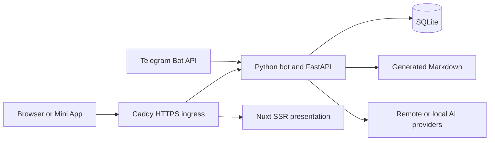

# Architecture

Chatterlore learns scoped Telegram memory and answers questions from that memory. Python owns ingestion, authorization, persistence and AI calls. The Nuxt control plane presents the same services in a browser or Telegram Mini App.

## Runtime boundaries

Polling runs the Python bot without an HTTP server. The webhook deployment runs three services: Caddy on public ports 80/443, FastAPI on internal port 8080 and Nuxt on internal port 3000. Caddy sends `/api/control`, `/api/control/*`, `/auth`, `/auth/*`, `/telegram/webhook` and `/health` to FastAPI, and other paths to Nuxt. It strips `Cookie`, `Authorization` and `X-CSRF-Token` from the Nuxt upstream. Nuxt has no database, provider credentials or application business API.  
The combined development command starts loopback FastAPI and Nuxt under one browser origin. Its backend-selected mock identity exists only in `chatterlore control-plane-dev`. Offline development creates no Telegram bot object or Telegram API traffic. See [setup](setup.md) and [deployment](deployment.md) for the runtime choices.

## Application composition and ownership

`build_context(Settings)` in `src/chatterlore/app_context.py` configures logging, applies Alembic migrations, constructs the provider registry and async session factory, refreshes managed providers, creates `MemoryService`, ensures the Markdown store exists, reconciles daily projections, refreshes runtime settings and constructs `AdminService`. With the control plane enabled, it also loads managed authority and installs the active-chat access gate. Tests and tools that own schema setup can pass `ensure_schema=False`.

| Module | Responsibility |
| --- | --- |
| `telegram` | Dispatcher, command-family routers, scope extraction, admin checks, polling/webhook transports, safe replies and request-local progress |
| `memory` | Policy, retrieval, summaries, notes, reviews, transfer, settings, profiles, retention, forgetting and index migration orchestration |
| `db` | SQLAlchemy models, Alembic schema and repositories over SQLite |
| `ai` | Provider protocols, fake/OpenAI-compatible/embedded implementations, redaction, request policy and credential pools |
| `control_plane` | Telegram identity, sessions, authorization, managed chats/admins, provider vault and HTTP business APIs |
| `web` | Nuxt file-based routes, client session bootstrap, forms, generated API types and SSR presentation |

`MemoryService` is the service facade. Its collaborators live in `memory.contracts`, `transfer`, `provider_operations`, `settings_profiles`, `retrieval_service`, `mutation_service` and `summary_service`. Telegram imports this public facade, memory and database modules do not import Telegram. Repository implementations live under `db.repos`, and `db.repositories` re-exports the public repository API.  
`telegram.router` composes command families from `telegram.routers`. `control_plane.app` composes HTTP families from `control_plane.api`, shared request/auth/rate-limit helpers live in `api.common`. Route modules do not import the app facade.  
Services own transactions through `session_scope(...)`. Repositories receive a session and do not commit. Services read immutable inputs, close the read transaction, call a provider, then persist results in a short transaction. Failed-call telemetry commits after rollback or claim release, so provider failure cannot commit a partial business mutation.

## Scope and ingestion

A scope is global, a whole chat or one topic. `Scope.contains(...)` and repository `scope_filter(...)` implement the hierarchy. Telegram General forum messages normalize to topic 1, ordinary non-forum messages retain a NULL thread. Topic retrieval excludes sibling topics and aggregate NULL-thread history, whole-chat retrieval includes them. Imports without reliable topic provenance stay aggregate until an operator selects an explicit target topic. See [concepts](concepts.md) for scope syntax, learning policy and access rules.  
Ingestion first checks managed-chat access. An inactive managed chat stops before message persistence. For messages that reach policy evaluation, learning-denied messages can still have raw and normalized text stored with `learned=false` and a skip reason. Only eligible learned content proceeds to embeddings and retrieval. Learning consent therefore differs from raw-storage retention, see [privacy](privacy.md).  
The logical message key is `(chat_id, message_thread_id, telegram_message_id)`. SQLite's authoritative unique expression index normalizes a NULL thread to the reserved index-only sentinel `-1`. Stored scopes keep NULL. Insert uses `ON CONFLICT DO NOTHING ... RETURNING`, concurrent redelivery resolves to the existing message without rolling back the caller's transaction. SQLite cannot reflect this expression index for Alembic comparison, so focused tests inspect `sqlite_master` alongside the migration drift check.  
Policy evaluation loads one immutable transaction-local snapshot. It applies chat/topic/user precedence without repeated policy queries and does not cache the snapshot across operations. Cross-chat memory profiles expand retrieval only with explicit destination-to-source permission and enabled source learning, they do not copy memory into the destination.

## Memory persistence and summaries

SQLite stores raw messages, durable `knowledge_items`, pending reviews, vectors, settings, permissions, audit events and control-plane state. Knowledge items include kind, scope, source IDs and metadata such as note tags, priority, range bounds and import provenance. Pending reviews stay outside generated Markdown until approval creates durable knowledge.  
The Markdown store contains daily projections at `daily/YYYY-MM-DD/<chat_id>_<thread_id>.md` and canonical `MEMORY.md`. Daily projection reconciliation reads committed knowledge and needs no provider call. Canonical compaction uses per-scope `canonical_scope_snapshots`, whose fingerprints cover content and output-affecting provider/prompt settings. Unchanged scopes reuse committed snapshots. Concurrent source/settings changes invalidate provider results before commit, failed refreshes retain the last valid snapshot for retry. SQLite remains authoritative.  
Summarization claims at most the effective `summary_batch_size` oldest eligible messages in an exact scope. Provider work runs outside transactions, finalization creates one knowledge item or review proposal only if the claim still owns its sources. Failed or empty output releases the claim and retains pending sources, abandoned claims become reclaimable after 900 seconds. Manual summarization drains eligible batches, ingestion processes at most one batch per update and an idle tick processes at most one batch per eligible scope.  
Import/export uses bounded streaming and independently committed import batches. JSON and HTML Telegram imports share exact-scope logical message IDs, so format changes do not duplicate a successful import. HTML follows validated local pagination without executing scripts or fetching attachments. [Operations](operations.md#imports-and-exports) describes limits and recovery.

## AI routes and embedding spaces

AI provider profiles select an implementation, endpoint, capabilities, models and credential policy. Memory profiles select permissioned source scopes. These are separate concepts. `chat_provider_profile`, `summary_provider_profile` and `embedding_provider_profile` independently fall back to `provider_profile`, with global/chat/topic and one-shot overrides. An explicit provider boundary selects that profile's model unless an equally specific or more specific model override applies. Null scoped values remove an override.

| Operation | Provider route |
| --- | --- |
| Ingestion, notes, imports, edits and review approval | Embedding route indexes content |
| Search | Query embedding route, with current coverage required in the selected space |
| Ask | Search followed by the chat route, insufficient context skips answer generation |
| Pending/range summaries, item refresh and canonical compaction | Summary route |
| Consent, permissions, skip classification and exports | Application logic |

OpenAI-compatible providers support `auto`, `openai`, `deepseek` and `generic` dialects. Unsupported reasoning options stay out of requests, telemetry distinguishes requested and effective effort. Redaction applies at the outbound provider boundary. No-auth local HTTP profiles cannot inherit a remote key, local origins require deployment allowlisting and redirects are forbidden. Embedded local inference loads optional dependencies and pinned artifacts on demand, uses bounded off-loop execution and exposes preparation/load/inference as distinct states. Ordinary metadata views do not load a model or call a provider. See [configuration](configuration.md) for profile options.  
An embedding manifest identifies a semantic space by endpoint/backend/model/revision, actual dimensions and preprocessing/prompt/normalization policy. Retrieval compares vectors only within that space and against current source fingerprints. It admits durable knowledge first, then recent learned messages, up to `retrieval_candidate_limit` (5,000 by default) per authorized source scope. It applies the final `top_k` after merging results. Broad memory profiles multiply this work, the backend performs bounded SQLite scans rather than approximate nearest-neighbor indexing.  
A populated embedding-route change requires a resumable migration job. Jobs persist source IDs/hashes, progress, versions and leases, provider calls run outside write transactions. Activation rechecks coverage/settings and advances a persisted routing epoch, concurrent writers must retry embeddings if their captured epoch changed. Old indexes remain available for a checked rollback but do not receive automatic shadow updates. Legacy vectors stay `legacy_unverified` until rebuilt or adopted with original operator-attested provenance. See [index operations](operations.md#embedding-index-migrations).

## Identity, sessions and provider credentials

Browser login uses backend-owned Telegram OIDC Authorization Code with PKCE. Mini Apps exchange signed `initData` after HMAC and freshness validation. OIDC validation fixes RS256 and checks issuer, audience, nonce, identity and time claims. One-time browser transactions store a state hash and an encrypted PKCE verifier bound to the callback. Sessions store hashes of opaque bearer/CSRF values, and every API operation resolves current authority.  
Configured `BOT_ADMINS`, database-managed bot admins, delegated chat grants and Telegram-native membership resolve through shared authorization services. Only bot admins manage delegated grants. Scoped admins operate within active managed chats. Sensitive operations require fresh Telegram verification bound to the exact action, including provider credential changes and confirmed destructive lifecycle operations.  
Managed provider credentials use a per-secret data key, envelope encryption and deployment master keys. Environment credentials remain immutable and non-revealable. A managed OpenAI-compatible pool selects a sticky eligible key and traverses at most ten sources, with classified retries, cooldowns, disabling and recovery. Managed client caches include profile/credential revisions. Admin-health notifications use a persisted deduplicated outbox and sanitized per-admin deliveries. [Secrets](secrets.md) covers storage and rotation.

## Browser rendering and API contracts

Nuxt renders public identity/error routes and neutral protected-route gates on the server. After hydration, the client restores a same-origin session and loads authorized data. Session, CSRF, grants and provider data stay out of SSR hydration payloads. Protected documents use private/no-store responses and a fresh nonce for inline scripts, hashed assets use immutable caching. Mini App proof and browser CSRF values stay in page memory, controlled credential reveals clear within 30 seconds or earlier on lifecycle changes.  
The backend OpenAPI snapshot in `web/openapi/` and generated declarations in `web/app/types/` define the client contract. Tests check snapshot/type drift, authorization, SSR gates and generated assets for secret material. Nuxt uses its file-based router and auto-imports, `~/` resolves inside `app/` and `~~/` resolves at the workspace root.  
Query APIs authorize scopes before retrieval. Memory detail exposes durable knowledge, raw sources require a separate audited POST with at most 100 exact source messages. Exports stream with private/no-store headers and disconnect cleanup. Statistics aggregate in SQL, audit/usage APIs keyset-page bounded sanitized records. Routine diagnostics use metadata, only explicit bot-admin checks can invoke paid providers, inspect integrity or prepare a local model.

## Telegram delivery and process lifetime

`safe_answer` and `safe_answer_document` centralize delivery bounds and sanitized transport errors. Model Markdown passes through the parser with raw HTML and image rules disabled before rich-message conversion, application status values use literal blocks. Rich chunks preserve paragraphs, list numbering, table headers and code context where possible. Definite rich-format rejection permits literal fallback, ambiguous network failure does not create another possibly duplicated send.  
OpenAI-compatible Ask streaming retains the provider's credential/request lifetime, excludes reasoning deltas and bounds time/output. Retry and key rotation can occur before visible output, partial output cannot trigger another generation. Private chats use temporary drafts and native Stop, groups/topics edit one progress message. Finalization persists complete source references, interruption produces an explicit notice. Non-streaming providers send completed replies.  
Webhook Ask commands in text or captions receive acknowledgement before generation. The process owns at most 128 answer tasks and remembers in-flight plus 256 recent completed update IDs for replay suppression. Overload returns 503, shutdown cancels and drains active work. These tasks are volatile, a restart can interrupt an acknowledged answer without automatic paid replay.  
Polling and webhook runtimes supervise summary/settings loops and the embedding-index worker, control-plane runtimes also deliver admin alerts. `/health` gates HTTP success on the summary and settings loops only, polling exposes no HTTP server. [Operations](operations.md) covers failure recovery and monitoring.
