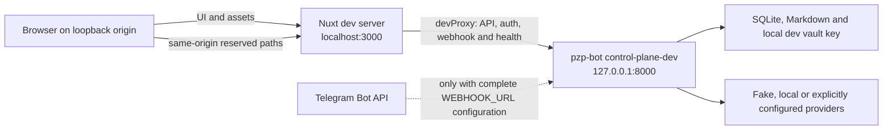

# Combined Control-Plane Development Mode Design

**Status:** Implemented and locally accepted on 2026-08-01, see the [completed execution plan](../plans/2026-08-01-control-plane-development-mode.md). This dated design records the original decision, current setup and release status live in `docs/setup.md`, `docs/testing.md` and `PLAN.md`.

**Decision:** Make `pnpm dev` launch a loopback Nuxt development server and a dedicated FastAPI control-plane development runtime with backend-selected mock identity, while optionally enabling the real Telegram webhook only when a complete webhook configuration is deliberately supplied. Production builds and runtimes retain the existing HTTPS, Telegram OIDC, webhook and secret requirements.

## Context

The current frontend command starts only Nuxt. Its Nitro development proxy forwards `/api` but not `/auth`, `/telegram/webhook` or `/health`, so the real browser authentication and reserved backend routes do not form one same-origin development application. The only current production FastAPI runtime is `pzp-bot webhook`, whose startup requires Telegram configuration and calls `setWebhook`; `pzp-bot polling` does not expose the HTTP control plane. This makes plain `pnpm dev` useful for public SSR and mocked browser tests but misleading as a complete live-development workflow.

The replacement must make local web development convenient without relaxing any production validation or allowing a browser-controlled mock identity. It must also preserve an explicit path for developers who deliberately want real Telegram updates and administrator DMs during development.

## Goals

- Start Nuxt and the Python control-plane backend together with one `pnpm dev` command from `web/`.
- Preserve `pnpm dev:web` for frontend-only work.
- Accept a loopback HTTP browser origin only in the explicit Python development runtime.
- Establish a normal persisted control-plane session for the positive integer configured by `CONTROL_PLANE_DEV_USER_ID`, with bot-admin capability and no Telegram OIDC redirect.
- Reuse real session, CSRF, authorization, audit, database, provider-profile, encrypted credential, key-pool and alert-history behavior after identity establishment.
- Keep the development identity and step-up endpoints absent from normal webhook, polling, schema/OpenAPI and production applications.
- Compile the automatic development-login branch only into the Nuxt development bundle.
- Work without contacting or mutating Telegram by default.
- Optionally register the real Telegram webhook and enable administrator-alert DMs when a complete webhook configuration is deliberately supplied.
- Keep development provider credentials decryptable across restarts without requiring production vault configuration merely to open the site.
- Preserve existing production HTTPS, OIDC, webhook, master-key and secure-cookie requirements exactly.

## Non-Goals

- A fake Telegram Bot API server or simulated incoming Telegram updates.
- A production authentication bypass, configurable mock identity in the production application or a client-supplied development UID.
- Supporting non-loopback insecure origins.
- Making Telegram deliver a real webhook to HTTP localhost; connected development still needs a publicly reachable HTTPS `WEBHOOK_URL`.
- Replacing the production Caddy ingress or Compose topology.
- Moving bot, OIDC, webhook, vault or provider secrets into the Nuxt environment.
- Adding a general-purpose process manager dependency.

## Developer Interface

From `web/`, `pnpm dev` runs the complete development topology. It invokes a small Node coordinator that starts `uv run pzp-bot control-plane-dev` from the repository root and starts Nuxt through `pnpm dev:web` from `web/`. The coordinator prefixes child output, forwards termination, shuts down the sibling when either child exits unexpectedly and returns a failing exit status for startup or child-process failure. Unix launches direct `uv` and `pnpm` children; Windows launches each command inside a persistent non-interactive PowerShell 7 wrapper and terminates the verified wrapper tree with `taskkill /T` because transient executable and `.cmd` shims can exit while their descendants retain inherited pipes.

`pnpm dev:web` runs only `nuxt dev`. `pnpm build`, `pnpm start` and direct `.output/server/index.mjs` execution remain production frontend operations and never launch Python.

The required development setting is:

```dotenv
CONTROL_PLANE_DEV_USER_ID=123456789
```

Optional development settings are:

```dotenv
CONTROL_PLANE_DEV_ORIGIN=http://localhost:3000
CONTROL_PLANE_DEV_API_PORT=8000
```

The Python command reads the repository-root `.env`; Nuxt receives no backend secret. `PZP_API_DEV_ORIGIN` remains a non-secret frontend override and defaults to `http://127.0.0.1:8000`.

## Process Topology



FastAPI remains the sole authentication, authorization, session, CSRF, vault and business-operation authority. Nitro is only a development same-origin proxy and UI renderer.

## Development Settings Boundary

The unsafe relaxation is command-scoped, not a generally activatable production setting. `pzp-bot control-plane-dev` constructs a development settings overlay after loading ordinary non-control-plane settings. It requires a positive `CONTROL_PLANE_DEV_USER_ID`, forces control-plane installation, uses the configured loopback development origin and binds the API listener to `127.0.0.1` on the configured development port.

Accepted development origins have scheme `http` or `https`, no credentials, path, query or fragment, and host exactly `localhost`, `127.0.0.1` or `::1`. HTTP on any other host is rejected. Normal `Settings` validation and `pzp-bot webhook` continue to require an HTTPS public origin and all production bootstrap credentials.

The development UID is added only to the in-memory bootstrap administrator set used by this development context. It is never written into `BOT_ADMINS`, a runtime setting or the database-managed administrator model. It must never be accepted from request data.

## Mock Development Authentication

The dedicated development application installs development login and step-up routes outside the production router/schema contract. A same-origin POST to `/api/control/v1/auth/dev` with no identity input creates a `TelegramIdentity` from `CONTROL_PLANE_DEV_USER_ID` and fixed visibly synthetic profile fields, issues a normal `browser` session, resolves normal authorization capabilities, writes the normal content-free authentication audit event and returns the existing session response shape. Request-guard middleware exempts only this installed development login path from session/CSRF validation after enforcing the exact development origin, matching the existing public Mini App exchange structure without accepting signed Telegram data.

The route replaces any existing session cookie through the standard session service. On loopback HTTP, the cookie remains `HttpOnly` and `SameSite=Lax` but uses `Secure=false`; normal HTTPS applications keep `Secure=true`. Logout must delete the cookie with the same effective security attributes.

In Nuxt development builds, browser session bootstrap first requests the normal session endpoint. If it receives 401, it calls the development-login route and accepts the returned session. Network, validation and authorization failures retain bounded user-visible error behavior. Production builds compile `import.meta.dev` to false and do not call or expose the development bootstrap branch.

The mock identity changes only identity proof. Subsequent requests use real persisted sessions, rotated CSRF tokens, authorization resolution, capability gates, audit events, provider services and database state. A same-origin POST to `/api/control/v1/auth/dev/step-up` accepts only an action from the existing `SENSITIVE_ACTIONS` allowlist, requires the active development session plus valid CSRF, verifies that the session UID still matches `CONTROL_PLANE_DEV_USER_ID`, marks the existing session step-up for that exact action and emits a content-free development audit event. Nuxt development helpers may invoke this route immediately before a sensitive development action; production helpers retain the real Telegram step-up path. Neither development route exists in production, and the production `has_fresh_step_up` contract is not weakened.

## Development Vault Key

The control-plane runtime requires a valid stable master key even when no credential is immediately created. Development mode first uses valid configured `CONTROL_PLANE_MASTER_KEYS` and `CONTROL_PLANE_ACTIVE_MASTER_KEY_ID` values when both are present.

If production-style vault configuration is absent, the development command generates a random 32-byte key, stores it in an ignored file beneath `data/`, reuses it on later development runs and injects it only into the development settings overlay. The key value is never logged or returned through safe configuration output. Startup emits a warning that colocating a development key with the local database is convenience protection rather than a production secret-storage design. Normal webhook, polling, CLI and Compose paths never discover or use the development fallback key.

The key file is created atomically and must not be overwritten after database-managed credentials exist. Invalid or unreadable key material fails startup with a content-free remediation message rather than silently replacing the key and orphaning encrypted credentials.

## Optional Telegram Connectivity

Development remains Telegram-offline whenever `WEBHOOK_URL` is empty. A configured bot token by itself does not contact Telegram. Offline development starts the normal critical idle-summarizer and runtime-settings-refresher tasks, installs the control plane and health endpoint, keeps alert intents visible in the database/UI, but does not register commands, call `setWebhook`, expose a functional Telegram update receiver or start the administrator-DM delivery worker.

Setting a nonempty `WEBHOOK_URL` deliberately requests Telegram-connected development. That mode requires a nonempty `TELEGRAM_BOT_TOKEN`, a non-placeholder `WEBHOOK_SECRET` and a valid HTTPS webhook URL. It creates the real bot client, registers commands, calls `setWebhook`, exposes `/telegram/webhook`, starts administrator-alert delivery and closes the Telegram session during shutdown. The local browser origin may remain `http://localhost:3000`; Telegram's public webhook origin is an independent URL.

Partial activation fails closed. A webhook URL without a bot token, a blank or known-placeholder webhook secret, or a non-HTTPS webhook URL stops startup and reports which safe configuration requirement is missing. Provider/API results remain independent of alert-delivery failure as in production.

## Development Proxy Contract

Nuxt `devProxy` reserves and forwards these exact paths and descendants to `PZP_API_DEV_ORIGIN`:

| Development path | FastAPI responsibility |
| --- | --- |
| `/api/control` and `/api/control/**` | Session and control-plane JSON APIs |
| `/auth` and `/auth/**` | Development login plus real OIDC routes retained for production parity |
| `/telegram/webhook` | Optional real Telegram delivery |
| `/health` | Backend critical-task health |

Every proxy target repeats its mounted prefix because Nitro/H3 removes that prefix before `httpxy` builds the upstream URL. Restricting the API mount to `/api/control` also leaves Nuxt UI's internal `/api/_nuxt_icon` route local. Every other route remains Nuxt SSR/client routing. Production Nitro output does not provide these development proxies; production reserved-route routing remains Caddy's responsibility.

## Production Fail-Closed Contract

The normal production configuration and applications must remain unchanged in all material security properties:

- `CONTROL_PLANE_ENABLED=true` requires an exact HTTPS public origin, Telegram bot token, Telegram OIDC client ID and secret, valid master-key map and active master-key ID.
- `pzp-bot webhook` additionally requires a nonempty webhook URL and a safe non-placeholder webhook secret, then registers the real webhook.
- Production session cookies remain `Secure`, `HttpOnly` and `SameSite=Lax`.
- Production OpenAPI contains no development identity or step-up route.
- `pnpm build` and `pnpm start` neither start Python nor attempt mock authentication.
- Docker and Caddy receive no development UID or fallback development key.
- Setting `NODE_ENV`, `CONTROL_PLANE_DEV_USER_ID` or calling a guessed development URL cannot add the mock route to the normal FastAPI application.

## Failure Behavior

| Failure | Required result |
| --- | --- |
| Missing or invalid development UID | Coordinator/backend exits with a safe actionable message |
| Non-loopback development origin | Backend refuses startup |
| Nuxt child exits | Coordinator terminates FastAPI and returns failure |
| FastAPI child exits | Coordinator terminates Nuxt and returns failure |
| Ctrl+C | Both children receive graceful termination and the coordinator exits |
| Development login unavailable | UI shows the bounded session-load error without falling back to real OIDC automatically |
| Missing configured production vault key in development | Stable ignored development key is created once |
| Corrupt or unreadable development key file | Startup fails; the file is never silently replaced |
| Bot token set but webhook URL empty | Telegram remains untouched |
| Webhook URL set with incomplete/unsafe Telegram settings | Startup fails before contacting Telegram |
| Telegram registration fails in connected mode | Startup fails and closes the bot session |
| Alert delivery fails after connected startup | Safe delivery retry state changes; provider calls and critical health remain unaffected |
| Production bundle calls development login | Verification fails; this is a release-blocking regression |

## Test Strategy

Python tests are written first and prove development settings construction, positive UID validation, exact loopback-origin acceptance, non-loopback rejection, fallback-key persistence/corruption behavior and unchanged production validation. Application tests prove the development login issues a real persisted bot-admin session with CSRF, the development step-up requires that session and valid CSRF plus an allowlisted exact action, both routes are absent from the normal application and production OpenAPI, loopback cookies are non-secure and production cookies remain secure.

Runtime tests inject a fake Telegram bot and verify that an empty webhook URL performs zero Telegram calls even when a token exists, while a complete connected configuration registers commands/webhook and starts optional alert delivery. Partial activation must fail before any external call. Critical task health remains consistent with production semantics.

Frontend tests prove the development bootstrap occurs only after a normal 401, accepts the returned session and is absent from production behavior. Configuration tests prove every reserved route is proxied in development. The coordinator's process-spec construction, exit propagation and signal cleanup are tested through small pure helpers and bounded child-process fixtures rather than long-running manual processes.

Final verification includes focused Python and Nuxt tests, Ruff format/lint, `ty`, raw `pnpm typecheck`, Nuxt unit/component tests, OpenAPI drift, a production build, generated-asset secret/development-route scanning, SSR smoke, Playwright desktop/mobile checks and a fresh complete Python suite. A bounded manual smoke starts `pnpm dev`, confirms `/health`, automatic mock login and `/providers`, then terminates both children. Optional real Telegram connectivity is reported separately and is not claimed unless credentials and a public webhook URL are deliberately supplied.

## Documentation And Roadmap

Implementation updates `docs/setup.md`, `docs/deployment.md`, `docs/secrets.md`, `docs/testing.md`, `README.md`, `PLAN.md`, Plan 021 and `docs/THOUGHTS.md`. Documentation must distinguish frontend-only development, combined offline development, optional connected development and production Compose. It must warn that connected development calls `setWebhook` and changes Telegram's update mode.

## Acceptance Criteria

- With only a valid `CONTROL_PLANE_DEV_USER_ID`, valid ordinary storage settings and no Telegram webhook URL, `pnpm dev` starts both servers, browser session bootstrap authenticates that UID as a bot administrator and Telegram receives no calls.
- The development browser can use real session, CSRF, exact-action development step-up, provider-profile, credential, pool-health and alert-history APIs over one loopback origin without a Telegram OIDC round trip.
- Restarting development preserves decryptability of database-managed credentials through the stable ignored development key.
- Supplying a complete real webhook configuration activates Telegram updates and administrator DMs; incomplete configuration fails before contact.
- Stopping or failing either child leaves no orphaned sibling process.
- Normal webhook and built Nuxt production behavior continue to reject insecure/missing production configuration and expose no mock-auth route or development bootstrap.
