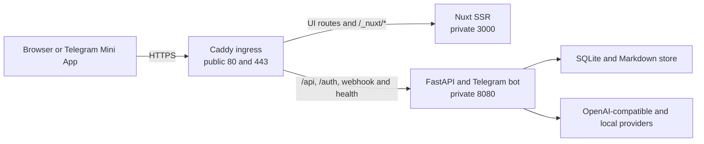

# Nuxt SSR And Caddy Deployment Design

**Status:** Implemented and non-Docker verified on 2026-08-01; live split-container/Caddy acceptance remains deferred.

**Decision:** Replace the generated client-only control-plane deployment with a Nuxt SSR Node service behind a dedicated Caddy ingress, while keeping FastAPI as the only identity, authorization, secret and business-operation authority.

## Context

The Phase 2 through Phase 4 control-plane frontend uses `ssr: false` and static generation. Direct route navigation therefore returns a generic loading document until the complete JavaScript application downloads and hydrates, which has produced a visible 20–30 second opening state on a cold development start. Serving generated static assets from the Python process would also couple frontend and backend releases even though they have separate dependency graphs and operational lifecycles.

The accepted replacement keeps one public HTTPS origin but gives the public edge, frontend renderer and backend API separate containers. The public origin remains important for the existing secure cookie, CSRF, Telegram OIDC callback, Mini App and no-CORS design.

## Goals

- Return meaningful route-specific HTML before client hydration.
- Keep every privileged session, CSRF value, provider secret and administrator data out of Nuxt SSR state and hydration payloads.
- Let the frontend and backend images build and deploy independently.
- Keep FastAPI routes, Telegram webhook traffic and streamed responses outside Nitro.
- Preserve local `uv run pzp-bot polling` operation while making the production Compose stack use webhook mode so its FastAPI control plane is reachable.
- Pin the frontend runtime to Node.js 24.18.0, pnpm 11.18.0 and the currently pinned Nuxt workspace.
- Make routing failures explicit instead of returning frontend HTML for unavailable API paths.

## Non-Goals

- Plan 021 Phase 5 provider-pool rotation, failure classification, cooldowns or administrator notifications.
- Server-side personalization or server-side control-plane API requests from Nuxt.
- A second public origin, credentialed CORS or a Nitro backend-for-frontend.
- Horizontal writers, multiple bot instances or any change to the SQLite ownership model.
- Claiming Docker build, TLS, health or restart acceptance while Docker Desktop is unavailable.

## Runtime Topology

Caddy is the only service with published host ports. Nuxt and FastAPI use Compose-internal `expose` declarations and service DNS. Caddy 2.11.4 Alpine is pinned exactly. The existing FastAPI webhook runtime remains on its established internal port `8080`.

## Ingress Contract

The Caddyfile uses mutually exclusive `handle` blocks. Exact and descendant backend paths are reserved before the frontend fallback:

| Public path | Upstream | Contract |
| --- | --- | --- |
| `/api` and `/api/*` | `bot:8080` | Control-plane JSON, streamed exports and future API routes |
| `/auth` and `/auth/*` | `bot:8080` | Telegram OIDC start, callback and step-up redirects |
| `/telegram/webhook` | `bot:8080` | Telegram Bot API delivery |
| `/health` | `bot:8080` | Backend and supervised-task readiness |
| `/_nuxt/*` | `frontend:3000` | Hashed immutable frontend assets |
| Every other path | `frontend:3000` | SSR documents and Nuxt client routing |

Reserved backend paths never fall through to Nuxt. A backend outage therefore yields a gateway error rather than a successful HTML document at an API URL. A frontend outage does not block the Telegram webhook or backend API.

Caddy keeps its access log disabled initially so OIDC callback query values are not copied into an additional log stream. It applies transport-level HSTS and compression. FastAPI and Nuxt retain application-specific CSP, no-store, MIME-sniffing, referrer and permissions headers.

## SSR Trust Boundary

Nuxt is a presentation renderer, not an authentication proxy. Caddy removes `Cookie`, `Authorization` and `X-CSRF-Token` before forwarding any frontend request. Backend requests retain their credential headers and go directly to FastAPI.

The frontend container receives no bot token, webhook secret, OIDC secret, master keys, provider keys, database URL or memory path. Its runtime environment contains only non-secret Node listener configuration and public browser API-path configuration already compiled as `/api/control/v1`.

Nuxt route middleware returns without authentication work during server rendering. `useControlSession.bootstrap()` also fails closed to a neutral unauthenticated result on the server as defense in depth. The server therefore never calls `/api/control/v1/session`, rotates CSRF, exchanges Mini App data or serializes a current user into the Nuxt payload.

Public routes such as `/login`, `/unauthorized` and error pages render their complete safe content on the server. Protected routes render the application shell, page metadata and a neutral Telegram-access pending state. Protected page controls appear only after client hydration and a successful browser-owned session bootstrap. The initial client render matches the neutral server state to avoid hydration mismatches.

## Response And Cache Policy

SSR documents receive `Cache-Control: private, no-store`, `Pragma: no-cache`, `X-Content-Type-Options: nosniff`, `Referrer-Policy: no-referrer`, a restrictive permissions policy, HSTS and a CSP that permits the same-origin Nuxt bundles plus the official Telegram Web App script. Each document receives a fresh 144-bit CSP nonce, Nuxt's server head marker exposes it to the renderer, and a Nitro render hook applies the same nonce to every generated inline bootstrap/payload script without enabling `script-src 'unsafe-inline'`. Protected HTML is never prerendered, SWR-cached or ISR-cached.

Only `/_nuxt/*` receives `public, max-age=31536000, immutable`. FastAPI keeps its existing no-store policy, including the stronger private reveal response.

## Images And Compose Lifecycle

`web/Dockerfile` uses separate dependency, build and runtime stages based on `node:24.18.0-bookworm-slim`. The dependency layer enables exactly pnpm 11.18.0, installs the frozen lock, the build layer runs `pnpm build`, and the runtime layer copies only `.output`, runs as the image's non-root `node` user and starts `.output/server/index.mjs` in production mode.

The root Python image remains independently buildable. The production Compose command changes from `pzp-bot polling` to `pzp-bot webhook`, sets the internal listener to `0.0.0.0:8080`, retains the data mount and receives all backend secrets through its existing optional untracked env file.

The frontend and bot have service-local HTTP health checks. Caddy validates its mounted configuration and depends only on the two services being started, not on cross-service restart propagation. An operator can rebuild and replace one service with `docker compose build <service>` followed by `docker compose up -d --no-deps <service>`.

Local bot development can continue with `uv run pzp-bot polling`. Browser control-plane deployment uses webhook mode because that is the existing runtime that owns FastAPI, Telegram webhook registration and supervised background tasks in one application process.

## Failure Behavior

| Failure | Result |
| --- | --- |
| Nuxt unavailable | UI routes return a gateway error; API, auth, health and Telegram webhook traffic still reaches FastAPI |
| FastAPI unavailable | SSR public shell remains reachable; reserved backend routes return a gateway error and hydrated UI requests enter the existing bounded error state |
| Caddy unavailable | The public origin is unavailable until the ingress container restarts |
| JavaScript unavailable | Public routes remain meaningful; protected routes retain the neutral authentication-required state and disclose no privileged content |
| Session expired | Client bootstrap receives the backend 401 and follows the existing login redirect |
| Frontend/backend contract drift | CI OpenAPI snapshot/type checks reject the drift before deployment |

## Verification Strategy

- Add client tests that prove protected content remains gated until an authenticated client state exists.
- Add a production SSR smoke runner that launches `.output/server/index.mjs`, fetches `/login` and `/`, asserts route-specific HTML and security headers, rejects the old SPA loading shell, verifies protected content remains absent, requires distinct per-response nonces on every inline script without `script-src 'unsafe-inline'` and scans the document plus hydration payload for sentinel deployment secrets.
- Keep generated browser-asset scanning focused on `.output/public`, which is the material delivered directly to browsers.
- Add JavaScript-disabled Playwright coverage for login and protected direct routes, plus the existing authenticated desktop/mobile hydration coverage.
- Parse Compose in Python tests to verify only Caddy publishes ports, FastAPI stays on `8080`, the bot runs webhook mode and the three images remain separate.
- Statically verify the Caddy reserved-route/header-stripping contract until the Caddy binary and Docker daemon are available, then run `caddy validate` and the live proxy acceptance through Compose.
- Replace the frontend CI static-generation gate with `pnpm build`, generated-asset scanning and the production SSR smoke.
- Run the established Python, frontend and OpenAPI gates. Do not start Plan 021 Phase 5.

## Deferred Runtime Acceptance

The implementation checkpoint may be called code-complete only for locally executable frontend/backend gates and static deployment-artifact verification. These deployment claims remain explicitly pending until Docker Desktop is available: image builds, container user/health inspection, `docker compose config`, live HTTP and HTTPS routing, automatic certificate behavior, header stripping at the real proxy, independent replacement, restart recovery and Telegram webhook registration from the Compose network.

## Authoritative References

- Nuxt Node deployment: https://nuxt.com/docs/4.x/getting-started/deployment
- Nuxt data fetching and payload serialization: https://nuxt.com/docs/4.x/getting-started/data-fetching
- Nuxt rendering modes: https://nuxt.com/docs/4.x/guide/concepts/rendering
- Caddy mutually exclusive handlers: https://caddyserver.com/docs/caddyfile/directives/handle
- Caddy reverse-proxy headers: https://caddyserver.com/docs/caddyfile/directives/reverse_proxy
- Caddy official image tags: https://hub.docker.com/_/caddy
- Compose startup and health semantics: https://docs.docker.com/compose/how-tos/startup-order/
