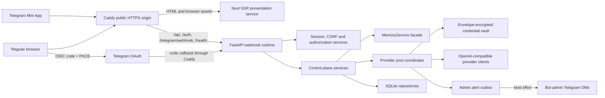

# Introduction

This plan adds two related product capabilities without weakening PZP AI's existing scope, privacy or service boundaries: a reloadless multi-key credential pool for each AI provider profile, and a responsive Telegram-authenticated control plane that works both as a Telegram Mini App and as a normal website.

The user approved this plan on 2026-07-30 with one execution constraint: stop after every numbered implementation phase for validation before beginning the next phase. Option A is the accepted secret-visibility policy: database-managed provider keys are masked by default but can be fully revealed by a bot admin after a fresh Telegram step-up authentication, through an audited, short-lived, non-cacheable response. After Phase 4, the user separately approved replacing the static SPA deployment with Nuxt SSR, Caddy ingress and independently deployable frontend/backend images before Phase 5, and explicitly authorized that transition without another approval pause.

The selected frontend is Nuxt 4 with Vue 3, TypeScript and Nuxt UI 4. Production runs Nuxt SSR as a presentation-only Node service behind Caddy, while FastAPI remains the sole identity, authorization, secret, persistence and business API owner. Caddy is the only public origin, routes reserved backend paths to FastAPI, routes every other path to Nuxt and strips credential-bearing headers before frontend proxying. Both browser OIDC and Mini App signed launch data resolve to the same server-side user, session and authorization model; protected Nuxt content remains behind a neutral server render until client-side session bootstrap succeeds.

PZP AI uses Telegram's current OpenID Connect Authorization Code flow with PKCE, an explicit BotFather client ID and secret, registered callback URLs, discovery metadata and JWKS validation. Mini App authentication separately exchanges server-validated signed `initData` for the same opaque session model.

## 1. Requirements & Constraints

### Product requirements

- **REQ-001**: Expose one responsive Nuxt control plane at the same public HTTPS origin as the FastAPI API, usable inside Telegram as a Mini App and in a regular desktop or mobile browser.
- **REQ-002**: Authenticate Mini App launches from server-validated `Telegram.WebApp.initData` and normal browsers through Telegram OpenID Connect Authorization Code flow with PKCE; do not add local passwords, password reset, email login or guessable admin credentials.
- **REQ-003**: Map both authentication paths to the same Telegram user identity, opaque server-side session and authorization rules.
- **REQ-004**: Preserve the existing authorization hierarchy: bootstrap and managed bot admins can operate globally; Telegram-native chat admins and explicitly delegated chat admins can operate only on authorized chats and topics.
- **REQ-005**: Allow bot admins to view and edit bot-wide non-secret runtime defaults, model allowlists, provider profiles, managed bot admins and operational settings without restarting the bot when the changed surface is designed for live refresh.
- **REQ-006**: Allow authorized chat admins to view and edit learning policy and scope settings for only their chats/topics, with the existing runtime → global → chat → topic precedence visible in the UI.
- **REQ-007**: Allow bot admins to add, reorder, test, disable, re-enable, replace, delete and reveal multiple database-managed API keys per AI provider profile without editing environment variables or restarting the process.
- **REQ-008**: Keep environment-backed provider credentials available as immutable bootstrap/recovery sources, visibly labeled as environment-managed and non-revealable in the control plane; a bot admin may add an equivalent database-managed key when UI reveal and rotation are required.
- **REQ-009**: Use sticky healthy-key selection per provider profile, retry the selected key only when the classified failure is retryable, rotate through each eligible key at most once per logical provider call, persist key health across restarts and return one controlled pool-exhausted error after the bounded traversal.
- **REQ-010**: Notify configured bot admins by sanitized best-effort Telegram DM when a credential enters cooldown, becomes hard-disabled, recovers, or leaves a pool exhausted, while ensuring notification failure never changes provider-call success or failure.
- **REQ-011**: Allow bot admins to enroll known Telegram groups, use Telegram Mini App `requestChat` where supported, pause ingestion, resume a group, detach while preserving memory, optionally make the bot leave the Telegram chat and separately run the existing destructive forget workflow.
- **REQ-012**: Allow bot admins to add or remove managed bot admins and delegated chat admins; delegated chat-admin grants must be bound to numeric Telegram identities and verified chat membership where Telegram permits.
- **REQ-013**: Provide a query workspace for a selected chat/topic with separate Search and Ask modes, cross-chat memory-profile selection, provider/model selection, reasoning-effort selection for supported GPT-5 models and clear provider capability labels.
- **REQ-014**: Permit local MiniLM retrieval in Search mode and as an explicitly selected retrieval provider, but never pretend the existing local sentence-transformer provider can generate chat responses; Ask must require a chat-capable provider and the UI must explain unavailable combinations.
- **REQ-015**: Provide bot and scope dashboards showing uptime, background-task health, database and memory-file sizes, schema revision, local-model availability/load state, provider/key-pool health, configured and managed chats/admins, ingested/skipped/summarized message counts, knowledge/embedding/review counts, AI call/error/latency totals and alert backlog.
- **REQ-016**: Provide a paginated memory explorer for durable knowledge, notes, summaries and pending reviews, with scoped search/filtering, item detail, source references, existing item maintenance actions and streamed Markdown/JSONL export.
- **REQ-017**: Keep raw learned-message bodies out of default list views; retrieving raw source text for an individual memory item must be an explicit authorized action, be audited and return only the bounded source rows associated with that item.
- **REQ-018**: Replace Telegram confirmation tokens in the web UI with authenticated direct mutations, visible before/after diffs and ordinary confirmation modals; destructive or privilege-changing actions still require deliberate confirmation and, where specified, fresh step-up authentication.
- **REQ-019**: Expose audit events, provider usage and credential health history without exposing provider prompts, raw provider errors, tokens, decrypted secrets or credential-bearing URLs.
- **REQ-020**: Keep the Telegram command and CLI surfaces functional; the control plane is an additional interface over shared application services rather than a replacement or parallel business-logic implementation.

### Security requirements

- **SEC-001**: Validate Mini App `initData` with the documented HMAC-SHA-256 construction using the bot token, compare hashes in constant time, require a numeric Telegram user, reject future timestamps and reject payloads older than `CONTROL_PLANE_AUTH_MAX_AGE_SECONDS`, default 300 seconds.
- **SEC-002**: Use Telegram's OIDC discovery document at `https://oauth.telegram.org/.well-known/openid-configuration`, Authorization Code flow, S256 PKCE, random state, random nonce, an exact registered redirect URI and server-side token exchange authenticated with the BotFather client ID and client secret.
- **SEC-003**: Validate OIDC ID-token signature against Telegram JWKS with the deployment-fixed `RS256` algorithm, refresh cached JWKS once on an unknown key ID and require exact issuer, exact audience, `exp`, `iat`, nonce and numeric Telegram `id` claims; never derive the OIDC client ID or client secret from `getMe`.
- **SEC-004**: Store control-plane sessions server-side and put only a 256-bit random opaque token in a `Secure`, `HttpOnly`, `SameSite=Lax`, path-scoped cookie; persist only a SHA-256 token hash, enforce idle and absolute expiry and support immediate revocation.
- **SEC-005**: Require an in-memory CSRF token bound to each session plus strict same-origin `Origin`/`Referer` validation for every mutating API request; do not put bearer tokens, sessions, CSRF tokens, PKCE verifiers or secrets in local storage, session storage, URLs or Nuxt public runtime configuration.
- **SEC-006**: Keep `TELEGRAM_BOT_TOKEN`, `WEBHOOK_SECRET`, Telegram OIDC client secret, active master-key material and previous master-key material as bootstrap deployment secrets that the control plane can diagnose only as present/missing and can never display, replace or export.
- **SEC-007**: Encrypt every database-managed provider credential with a random 256-bit data-encryption key using AES-256-GCM and credential-specific authenticated additional data; wrap each data-encryption key with a master-key-derived key so rotating the active master key requires rewrapping data keys rather than decrypting and rewriting every provider secret.
- **SEC-008**: Read master keys from `CONTROL_PLANE_MASTER_KEYS`, a JSON object mapping stable key IDs to base64-encoded 32-byte values, and select the write key through `CONTROL_PLANE_ACTIVE_MASTER_KEY_ID`; fail closed when a referenced master key is absent or malformed.
- **SEC-009**: Derive independent key-wrap and fingerprint subkeys through HKDF-SHA-256 with fixed domain-separation labels; store only encrypted secret fields, master key ID, a keyed non-reversible fingerprint and the last four display characters.
- **SEC-010**: Permit full reveal only for database-managed provider credentials, only to a current bot admin, only after a step-up authentication no older than 300 seconds and only through `POST`; emit `Cache-Control: no-store, private`, `Pragma: no-cache`, `Referrer-Policy: no-referrer` and an audit event before returning the value.
- **SEC-011**: Hold a revealed key only in component memory, mask it automatically after 30 seconds and immediately clear it on route change, component unmount, page hide, logout or session invalidation; never put the value into global Nuxt state, telemetry, error messages, HTML hydration payloads or clipboard without a separate explicit Copy action.
- **SEC-012**: Exclude auth payloads, OIDC codes/tokens, CSRF values, provider-key request/response bodies and decrypted provider keys from structured request logs, exception text, audit payloads, traces, snapshots, generated OpenAPI examples and test fixtures.
- **SEC-013**: Classify provider failures from safe exception type, HTTP status and allowlisted provider error code only; never persist or DM the raw provider response body or exception message.
- **SEC-014**: Rate-limit authentication initiation/callback, Mini App exchange, step-up, secret mutation/reveal, credential testing, Ask/Search and export endpoints independently; repeated authentication or reveal failures must produce content-free audit/security events.
- **SEC-015**: Serve the UI and API from one origin by default, disable credentialed cross-origin access, allow Telegram web clients through a tested CSP `frame-ancestors` rule, and add `nosniff`, restrictive `Permissions-Policy`, safe referrer and non-cache headers to authenticated HTML/API responses.
- **SEC-016**: Re-evaluate bot-admin and scoped-admin authorization on every request or against a short-lived versioned cache; removing a grant must revoke or invalidate affected sessions immediately and must not wait for a long cookie lifetime.
- **SEC-017**: Prevent last-owner lockout by treating `BOT_ADMINS` as immutable bootstrap owners and refusing to remove them from the UI; database-managed bot-admin grants are reloadable and removable but cannot reduce the effective bot-admin set to zero.
- **SEC-018**: Use optimistic concurrency versions for bot settings, scope settings, provider profiles, credential order/state and admin grants; a stale write returns HTTP 409 with the current safe representation instead of silently overwriting another admin's update.
- **SEC-019**: Require typed or exact-name confirmation plus fresh step-up for provider credential deletion, bot-admin removal, group detach-and-leave and destructive memory forget; confirmation is a UI interaction and not a reusable Telegram token.
- **SEC-020**: Keep backups containing encrypted provider secrets sensitive, document master-key recovery separately and make a database restore fail closed until every referenced master key is available.

### Constraints and preserved boundaries

- **CON-001**: The supported v1 topology remains one application instance with SQLite plus rebuildable Markdown; multi-process distributed key leasing, distributed rate limiting and horizontal writers are out of scope.
- **CON-002**: Production application wiring continues through `build_context(Settings)`, service database access continues through `session_scope(...)` and repositories, and new schema requires SQLAlchemy models, Alembic revisions and focused upgrade/runtime tests.
- **CON-003**: `MemoryService` remains the stable memory facade. Control-plane APIs must call existing service/collaborator methods or new cohesive services; they must not duplicate command parsing, scope authorization, export, query, settings or mutation logic in Nuxt.
- **CON-004**: Existing scope grammar and hierarchy remain authoritative through `Scope`, `parse_scope`, `Scope.contains(...)` and repository `scope_filter(...)`.
- **CON-005**: Existing model policy remains limited to the approved non-Pro GPT-5 aliases (`gpt-5.4`, `gpt-5.4-mini`, `gpt-5.4-nano`, `gpt-5.5`, `gpt-5.6-luna`, `gpt-5.6-terra`, `gpt-5.6-sol`), OpenAI-compatible embeddings and configured local embeddings unless a later reviewed plan changes the allowlists; Pro aliases stay excluded.
- **CON-006**: The current local sentence-transformer provider supplies embeddings only and returns `local-chat-unavailable` for generation; UI capability discovery must represent this accurately.
- **CON-007**: Telegram bots cannot initiate a DM with a user who has never opened the bot; alert delivery must surface `unreachable` safely and continue serving provider calls.
- **CON-008**: Telegram does not provide arbitrary group discovery or historical backfill. Group enrollment requires a Telegram selection/add flow, a known chat update or an operator-entered known chat ID that is verified through Bot API access.
- **CON-009**: Nuxt uses SSR only for the public shell and neutral protected-route fallback; authentication bootstrap and protected data remain client-only, and no authenticated user, CSRF value, decrypted secret or backend runtime secret may be serialized into SSR HTML or its hydration payload.
- **CON-010**: Use Node.js 24 LTS, pnpm with a committed frozen lockfile, Nuxt 4, Vue 3, TypeScript and Nuxt UI 4; verify and pin exact stable package versions at execution time rather than using `latest` ranges.
- **CON-011**: Python remains 3.12 and uv-managed. Add only focused runtime dependencies for authenticated encryption and OIDC/JWT validation, pin them in `pyproject.toml` and refresh `uv.lock` deliberately.
- **CON-012**: Keep default Python and frontend tests offline. Real Telegram Mini App, OIDC, DM and provider-key checks are explicit live acceptance gates with disposable data and dedicated credentials.
- **CON-013**: Preserve bot-only polling for local/manual operation and use webhook mode for the production control-plane Compose topology. Nuxt and Caddy are presentation/ingress processes only; the single FastAPI bot process remains the only SQLite writer, and polling must never run beside that webhook writer against the same database.
- **CON-014**: Do not expose FastAPI Swagger UI or the complete control-plane OpenAPI schema anonymously in production; generated client types may be built from the schema during development/CI.

### Implementation guidelines and patterns

- **GUD-001**: Build the smallest coherent control plane first: authentication, authorization, settings, provider keys, chats, query, memory, status and audit; do not add billing, multi-tenant organizations, arbitrary plugins or a general workflow engine.
- **GUD-002**: Keep API responses typed, paginated and bounded. Use keyset pagination for large append-only memory/audit lists and existing streaming generators for exports.
- **GUD-003**: Reuse Nuxt UI dashboard, form, table, modal, drawer, toast and accessible navigation primitives; use lightweight local SVG charts for the first stats release instead of introducing a charting framework.
- **GUD-004**: Use Nuxt `useState`, route middleware and typed composables for session and page state; do not add Pinia until concrete cross-page state complexity proves it necessary.
- **GUD-005**: Generate TypeScript API types from FastAPI OpenAPI in CI and fail on an uncommitted schema/client drift; do not hand-maintain duplicate request/response interfaces.
- **GUD-006**: Make every UI action display the effective target scope and actor capability before submission, especially when a bot admin is operating on another chat from a browser or bot DM context.
- **GUD-007**: Keep security-sensitive services small and independently testable: Mini App validation, OIDC, sessions/CSRF, authorization, secret encryption, credential pool selection/classification and alert outbox must not be one module.
- **GUD-008**: Update `PLAN.md`, `plans/README.md`, architecture, setup, privacy, secrets, commands, operations, deployment, testing and release docs as their behavior lands; planning labels are not implementation evidence.
- **PAT-001**: Use a Backend-for-Frontend-shaped same-origin API boundary, but keep it in FastAPI. Nuxt owns presentation and calls `/api/control/v1/*`; FastAPI owns identity, authorization, secrets, persistence and business orchestration.
- **PAT-002**: Use a database-backed opaque-session pattern rather than a stateless signed session so admin removal, account switch, logout and incident response can revoke sessions immediately.
- **PAT-003**: Use an outbox pattern for bot-admin alerts so provider calls commit only safe health state and alert intent; Telegram delivery occurs asynchronously and cannot break the original call.
- **PAT-004**: Use an environment-bootstrap plus database-overlay pattern. Environment provider profiles/credential references remain recovery inputs; database-managed provider profiles and encrypted credentials become reloadable authoritative overrides by name.
- **PAT-005**: Use a profile-scoped pool coordinator with stable credential order, a persisted active credential and versioned compare-and-swap transitions; keep an in-process per-profile `asyncio.Lock` as a contention optimization, not as the only correctness mechanism.
- **PAT-006**: Use capability discovery (`chat`, `embedding`, `reasoning`, `secret_required`, `local`) to drive UI choices and backend validation; never infer capability solely from a model-name string in the browser.
- **PAT-007**: Use explicit lifecycle states for managed chats and credentials instead of overloading booleans or deleting operational history.

### Chosen architecture

Caddy is the only public service. It sends `/api`, `/auth`, `/telegram/webhook` and `/health` to the private FastAPI webhook runtime, sends all other paths to the private Nuxt Node service and removes cookies, authorization and CSRF headers before a request can reach Nuxt. The Nuxt development server still proxies the reserved paths to FastAPI so local development preserves same-origin cookie semantics. Nitro never owns authentication, authorization, secrets, provider calls or database access.

`create_http_app(context, *, telegram_bot, dispatcher, include_webhook)` remains the FastAPI HTTP composition root. The production Compose topology runs exactly one bot process in webhook mode; the independent Nuxt and Caddy processes do not import the Python application or touch SQLite. `CONTROL_PLANE_ENABLED=false` still preserves bot-only polling/local operation, while an enabled production control plane requires the HTTPS public origin, OIDC bootstrap settings and master-key configuration before secret management or browser login becomes healthy.

### Identity and authorization matrix

| Capability                        | Unauthenticated | Authenticated non-admin | Telegram/delegated chat admin      | Managed bot admin      | Bootstrap bot admin    |
| --------------------------------- | --------------- | ----------------------- | ---------------------------------- | ---------------------- | ---------------------- |
| View login/config/health summary  | Login only      | Own session only        | Own session plus authorized scopes | Global                 | Global                 |
| View/edit chat or topic settings  | No              | No                      | Authorized chat/topic only         | Any scope              | Any scope              |
| Query/browse/export memory        | No              | No                      | Authorized chat/topic only         | Any scope and `all`    | Any scope and `all`    |
| Pause/resume managed chat         | No              | No                      | Own chat only when policy permits  | Any chat               | Any chat               |
| Enroll/detach/leave chat          | No              | No                      | No                                 | Yes                    | Yes                    |
| View/edit bot runtime defaults    | No              | No                      | No                                 | Yes                    | Yes                    |
| Manage provider profiles and keys | No              | No                      | No                                 | Yes                    | Yes                    |
| Reveal a database-managed key     | No              | No                      | No                                 | Fresh step-up required | Fresh step-up required |
| Manage delegated chat admins      | No              | No                      | No                                 | Yes                    | Yes                    |
| Add/remove managed bot admins     | No              | No                      | No                                 | Managed grants only    | Managed grants only    |
| Remove bootstrap bot admin        | No              | No                      | No                                 | Never                  | Never                  |

Authentication does not itself grant access. A Telegram user may establish a session and still receive an authorization-denied page until they are a bootstrap/managed bot admin, a Telegram-native admin of a known chat or a delegated admin. The API returns an explicit capability document from `GET /api/control/v1/session`, and Nuxt uses it only for presentation; every endpoint enforces authorization again server-side.

### Session and step-up contract

The browser starts at `GET /auth/telegram/start?return_to=<relative-path>`. FastAPI creates a 10-minute OIDC transaction containing a state hash, nonce, encrypted PKCE verifier, safe relative return path and optional `step_up_for` action, then redirects to Telegram. `GET /auth/telegram/callback` consumes the transaction exactly once, exchanges the code, validates the ID token, upserts the control-plane user, issues or upgrades the session and redirects to the saved relative path. Absolute external return URLs are rejected.

The Mini App plugin loads Telegram's official Web App script client-side, waits up to five seconds for `window.Telegram.WebApp`, and sends `initData` once to `POST /api/control/v1/auth/mini-app`. FastAPI validates the signed data, upserts the same Telegram identity and issues the same session cookie. If an existing cookie belongs to another Telegram identity, the exchange revokes the old session before issuing the new one. Mini App `initDataUnsafe` may guide display before login but is never an authorization input.

Normal sessions have a 12-hour idle timeout and a seven-day absolute timeout. Successful browser OIDC or fresh Mini App exchange sets `verified_at`. Secret reveal and specified privilege/destructive operations require `verified_at` within five minutes. An older browser session restarts OIDC with an action-bound transaction. An older Mini App session instructs the user to close and reopen the Mini App to obtain fresh signed launch data; optional Telegram biometric support is explicitly deferred because it is device-local and does not replace server-verified Telegram identity.

### Secret-vault contract

Each database-managed provider credential receives a random 32-byte data-encryption key and two random 12-byte AES-GCM nonces. The credential value is encrypted with the data key and authenticated additional data `pzp-ai|provider-credential|v1|<credential-id>|<profile-name>`. The data key is wrapped with the active master-key-derived wrap key and authenticated additional data `pzp-ai|wrapped-dek|v1|<credential-id>|<master-key-id>`. A separate HKDF-derived fingerprint key produces a stable HMAC-SHA-256 fingerprint truncated to 16 hexadecimal characters for audit correlation; the raw SHA-256 of a key is never stored.

The control plane returns masked metadata by default: label, source kind, final four characters for database-managed keys, fingerprint, stable order, state, last success/failure timestamps and cooldown. Environment-backed entries return the environment variable name and health state but no last four or reveal capability. Decryption occurs only immediately before constructing a provider client or serving a successful step-up reveal, and plaintext references are discarded as soon as the operation finishes.

Master-key rotation adds the new key to `CONTROL_PLANE_MASTER_KEYS`, sets `CONTROL_PLANE_ACTIVE_MASTER_KEY_ID`, runs `pzp-bot secrets rewrap --to <id>`, verifies every credential can be decrypted through the new wrapped data key, backs up the database and only then removes the old master key in a later deployment. The CLI logs counts and key IDs only.

### Provider-pool state machine and failure classification

Credential states are `untested`, `healthy`, `cooldown`, `disabled` and `deleted`. Manual disable uses `disabled` with reason `manual`; authentication, permission and exhausted-quota failures use `disabled` with a safe classified reason. Cooldown retains `cooldown_until`; expired cooldown entries become eligible but remain visibly degraded until a successful call returns them to `healthy`.

Selection first reuses the persisted active credential if eligible. Otherwise it advances through enabled credentials in stable `(position, id)` order, wrapping once. Authentication and hard-disable classifications rotate immediately without same-key retry. Transient connection, timeout and server failures use the existing bounded exponential same-key retry and then place that key in short cooldown before rotating. A logical request attempts no credential more than once after its same-key retry budget and never traverses more than ten eligible credentials. Profile creation rejects more than ten enabled database/environment credential sources so total provider work remains bounded.

| Installed OpenAI SDK 2.50.0 classification                                                | Same-key retry | State transition                                     | Rotate | Admin alert                           |
| ----------------------------------------------------------------------------------------- | -------------- | ---------------------------------------------------- | ------ | ------------------------------------- |
| `BadRequestError`, `NotFoundError`, `UnprocessableEntityError`, other non-408/non-409 4xx | No             | None                                                 | No     | Configuration/request audit only      |
| `AuthenticationError`                                                                     | No             | `disabled:authentication`                            | Yes    | Immediate deduplicated DM             |
| `PermissionDeniedError`                                                                   | No             | `disabled:permission`                                | Yes    | Immediate deduplicated DM             |
| `RateLimitError` with allowlisted `insufficient_quota` code                               | No             | `disabled:quota`                                     | Yes    | Immediate deduplicated DM             |
| Other `RateLimitError`                                                                    | No             | `cooldown:rate_limit`, respect bounded `Retry-After` | Yes    | One DM per credential/cooldown window |
| `APITimeoutError`, `APIConnectionError`                                                   | Yes            | `cooldown:transport` after retry exhaustion          | Yes    | Deduplicated degraded-pool DM         |
| `InternalServerError` or other 5xx `APIStatusError`                                       | Yes            | `cooldown:provider` after retry exhaustion           | Yes    | Deduplicated degraded-pool DM         |
| HTTP 408 or 409 `APIStatusError`                                                          | Yes            | `cooldown:provider` after retry exhaustion           | Yes    | Deduplicated degraded-pool DM         |
| Unknown exception or malformed response                                                   | No             | None                                                 | No     | Content-free internal error event     |

The classifier may read only the exception class, numeric status, `Retry-After` and a small allowlist of provider error codes. It must not store or alert raw exception strings or response bodies. Invalid model/request payloads never damage credential health. A successful call marks the used credential healthy, resets transient counters, updates the active credential and may emit one recovery alert if the pool was previously degraded.

Pool health and alert intents are written in a short transaction after a failed call has released or rolled back its business state, following the existing provider-telemetry boundary. The alert outbox deduplicates by `(event type, profile, credential, health epoch)` and the non-critical alert worker sends safe DMs asynchronously. Exhaustion raises `ProviderPoolExhaustedError(profile, attempted_count, earliest_retry_at)`; user-facing layers convert it to one controlled message without key labels unless the caller is an authorized bot admin.

### Managed-chat lifecycle

Managed chat states are `pending`, `active`, `paused` and `detached`. `active` permits the normal policy engine to ingest updates. `paused` records incoming updates as skipped with a safe `chat_paused` reason, stops automatic summarization and preserves existing memory for authorized query/export. `detached` ignores new business processing, hides the chat from ordinary navigation and preserves its data and audit history for bot-admin recovery/export.

The add-group flow prefers Telegram Bot API 9.6 `savePreparedKeyboardButton` plus Mini App `requestChat` where the client and installed aiogram version expose it. The selected/created chat still becomes active only after the bot receives and verifies the shared chat, confirms its membership and records scope metadata. Regular browsers and older Telegram clients receive a bot-add deep link plus explicit steps, then the UI polls a bounded pending-enrollment endpoint.

Detach does not imply forget. A bot admin chooses among Pause, Detach while preserving data, Detach and call `leaveChat`, or Forget memory through the existing service. The UI never combines `leaveChat` and forget in one unreviewable click.

### Query, memory and status behavior

The query workspace contains two modes. Search selects an embedding-capable provider profile/model, including local MiniLM, and calls the existing scoped retrieval path. Ask selects a chat-capable provider profile/model/reasoning level plus an independently selected retrieval provider/model when implemented in the shared request contract. The Telegram command-compatible `provider_profile` remains a shorthand that chooses both sides; the new `retrieval_provider_profile` and `chat_provider_profile` fields are optional and one-shot. Stored scope defaults remain backward-compatible until a separately reviewed default-splitting change is required.

Every result displays the destination scope, authorized source scopes/profile, selected providers/models, reasoning level, elapsed time and compact source references. It never exposes hidden chain-of-thought. The UI may show provider-reported reasoning summaries only if the selected API explicitly returns a safe user-visible field and a later review approves that field.

The memory explorer defaults to durable knowledge and pending review metadata. Item detail may load bounded source rows after a second explicit action. Exports reuse the existing streaming Markdown/JSONL implementation and set sensitive download headers. Dashboard status uses SQL aggregates and filesystem metadata, never hydrates entire memory corpora and never invokes an external provider automatically. Manual provider/local-model diagnostics are explicit actions with cost/download warnings.

### API surface

All JSON endpoints use `/api/control/v1`. Safe list endpoints use cursor/limit parameters with a maximum page size of 100. Mutations return the new safe representation plus an audit event ID and version. HTTP 401 means no valid session, 403 means authenticated without capability, 409 means stale version/state conflict, 422 means validated input failure and 429 means a local rate limit.

| Method and path                                                                  | Purpose                                                    | Minimum capability                            |
| -------------------------------------------------------------------------------- | ---------------------------------------------------------- | --------------------------------------------- |
| `POST /auth/mini-app`                                                            | Validate fresh Mini App data and issue session             | Valid Telegram identity                       |
| `GET /session`                                                                   | Return actor, expiry, CSRF token and capabilities          | Authenticated                                 |
| `POST /auth/logout`                                                              | Revoke current session                                     | Authenticated                                 |
| `POST /auth/step-up/mini-app`                                                    | Refresh `verified_at` from fresh initData                  | Authenticated same identity                   |
| `GET /bot/settings` / `PATCH /bot/settings`                                      | View/update safe global runtime defaults                   | Bot admin                                     |
| `GET /bot/admins` / `POST /bot/admins` / `DELETE /bot/admins/{telegram_id}`      | Manage database-backed bot admins                          | Bot admin plus step-up for delete             |
| `GET /providers` / `POST /providers`                                             | List/create managed AI profiles                            | Bot admin                                     |
| `GET /providers/{name}` / `PATCH /providers/{name}` / `DELETE /providers/{name}` | Inspect/update/delete managed profile                      | Bot admin; step-up for delete                 |
| `GET /providers/{name}/credentials` / `POST /providers/{name}/credentials`       | List/add encrypted or environment-ref keys                 | Bot admin; step-up for add                    |
| `PATCH /providers/{name}/credentials/{id}`                                       | Rename, reorder, disable or re-enable key                  | Bot admin                                     |
| `POST /providers/{name}/credentials/{id}/reveal`                                 | Return a database-managed key for 30-second UI reveal      | Bot admin plus fresh step-up                  |
| `POST /providers/{name}/credentials/{id}/test`                                   | Test selected credential with constant safe input          | Bot admin                                     |
| `DELETE /providers/{name}/credentials/{id}`                                      | Crypto-delete credential ciphertext and tombstone metadata | Bot admin plus step-up and exact confirmation |
| `GET /chats` / `POST /chats/enrollments`                                         | List managed chats/start enrollment                        | Scoped results or bot admin enrollment        |
| `GET /chats/{chat_id}` / `PATCH /chats/{chat_id}`                                | View/update lifecycle and chat-level settings              | Authorized chat admin                         |
| `POST /chats/{chat_id}/pause` / `resume`                                        | Pause or resume ingestion                                  | Authorized chat admin                         |
| `POST /chats/{chat_id}/detach` / `leave`                                        | Detach while preserving memory; optionally leave Telegram  | Bot admin; fresh step-up for leave             |
| `GET /chats/{chat_id}/admins` / `POST` / `DELETE /{telegram_id}`                 | Manage delegated chat admins                               | Bot admin                                     |
| `GET /scopes/{scope_key}/settings` / `PATCH`                                     | View/update versioned scope overlay                        | Authorized scope admin                        |
| `GET /scopes/{scope_key}/policy` / `PATCH`                                       | View/update learning policy                                | Authorized scope admin                        |
| `POST /query/search`                                                             | Run scoped retrieval with one-shot embedding selection     | Authorized scope admin                        |
| `POST /query/ask`                                                                | Run scoped retrieval plus chat generation                  | Authorized scope admin                        |
| `GET /memory/items` / `GET /memory/items/{id}`                                   | Page durable memory and item detail                        | Authorized scope admin                        |
| `POST /memory/items/{id}/sources`                                                | Return bounded raw source rows and audit access            | Authorized scope admin                        |
| `DELETE /memory/items/{id}` / `POST /memory/items/{id}/refresh`                  | Existing item maintenance                                  | Authorized scope admin                        |
| `GET /memory/reviews`                                                           | Page pending reviews                                       | Persisted review-scope admin                   |
| `POST /memory/reviews/{id}/approve` / `reject`                                  | Apply the existing review workflow                         | Persisted review-scope admin                   |
| `GET /memory/export`                                                             | Stream Markdown/JSONL export                               | Authorized scope admin                        |
| `GET /stats/overview` / `GET /stats/timeseries`                                  | Bounded global/scoped status                               | Scoped or bot admin                           |
| `GET /audit/events`                                                              | Page safe audit events                                     | Scoped or bot admin                           |
| `GET /operations/health` / `POST /operations/checks/{name}`                      | Safe status/manual diagnostics                             | Bot admin                                     |
| `GET /alerts` / `POST /alerts/{id}/retry`                                        | View/retry sanitized alert delivery                        | Bot admin                                     |

Browser OIDC endpoints live outside the JSON prefix at `/auth/telegram/start` and `/auth/telegram/callback` because they use redirects. The frontend must not call Telegram's token endpoint or hold the OIDC client secret.

### Persistence model

| Table                     | Required purpose and important columns                                                                                                                                                                                                                 |
| ------------------------- | ------------------------------------------------------------------------------------------------------------------------------------------------------------------------------------------------------------------------------------------------------ |
| `control_plane_users`     | Unique `telegram_user_id`, current display metadata, first/last login, disabled timestamp and version                                                                                                                                                  |
| `control_plane_sessions`  | SHA-256 token hash, user ID, created/seen/idle/absolute expiry, `verified_at`, revoked timestamp/reason, CSRF-token hash and safe client metadata                                                                                                      |
| `oidc_auth_transactions`  | State hash, encrypted PKCE verifier, nonce, safe return path, action binding, expiry and consumed timestamp                                                                                                                                            |
| `bot_admin_grants`        | Managed Telegram user ID, granted/revoked actor/timestamps and version; bootstrap owners remain environment-only                                                                                                                                       |
| `chat_admin_grants`       | Chat ID, Telegram user ID, grant/revoke actor/timestamps and version                                                                                                                                                                                   |
| `managed_chats`           | Unique chat ID, lifecycle state, enrollment token/state, lifecycle actor/timestamps and version; display metadata remains in `scope_metadata`                                                                                                          |
| `ai_provider_profiles`    | Unique normalized name, provider kind, base URL, default models, capability flags, enabled/source/version and actor/timestamps                                                                                                                         |
| `ai_provider_credentials` | Profile FK, label, source kind, environment variable name or encrypted secret/wrapped DEK fields, master key ID, fingerprint, last four, order, lifecycle/health state, cooldown/error classification, success/failure counters/timestamps and version |
| `ai_provider_pool_state`  | Unique profile FK, active credential FK, health epoch, last exhaustion/recovery and compare-and-swap version                                                                                                                                           |
| `admin_alerts`            | Safe alert type/payload, dedupe key, recipient Telegram ID, state, attempts, retry time and delivery/error classification timestamps                                                                                                                   |

Use Alembic revision `0013_control_plane_identity_access` for users, sessions, OIDC transactions, admin grants and managed chats; revision `0014_provider_credential_pools` for provider profiles, encrypted credentials and pool state; revision `0015_admin_alert_outbox` for alert delivery. Every downgrade must remove only its own new surfaces and must never attempt to decrypt or export provider credentials.

## 2. Implementation Steps

### Implementation Phase 1: Approval, drift refresh and executable contracts

- **GOAL-001**: Freeze the reviewed design, refresh it against the execution commit and establish contract tests before production code changes.

| Task     | Description                                                                                                                                                                                                                                                                     | Completed | Date |
| -------- | ------------------------------------------------------------------------------------------------------------------------------------------------------------------------------------------------------------------------------------------------------------------------------- | --------- | ---- |
| TASK-001 | Obtain explicit user approval of this plan and record approved deviations in this file before editing application code.                                                                                                                                                         | DONE      | 2026-07-30 |
| TASK-002 | Run read-only worktree inspection and `git diff --stat f1d8cd1..HEAD -- PLAN.md plans docs src tests pyproject.toml uv.lock Dockerfile docker-compose.yml .github/workflows/ci.yml`; refresh stale paths, package versions and migration head without discarding user changes.  | DONE      | 2026-07-30 |
| TASK-003 | Inventory current `AppContext`, provider registry/cache, `MemoryService` query/settings/export facades, Telegram admin checks, webhook/polling lifecycles, scheduler health and existing OpenAPI routes; add characterization assertions before extraction or behavior changes. | DONE      | 2026-07-30 |
| TASK-004 | Write API request/response schemas and the authorization matrix from this plan as failing Python contract tests; declare pagination, error envelope, version-conflict and secret-redaction behavior before handler implementation.                                              | DONE      | 2026-07-30 |
| TASK-005 | Verify current official Telegram OIDC, Mini App, Bot API `requestChat`, Nuxt 4, Nuxt UI 4, Node LTS and security-library documentation at execution time; pin reviewed versions and record any upstream contract change in this plan and `PLAN.md`.                             | DONE      | 2026-07-30 |

Phase 1 evidence:
- Approval was explicit in the 2026-07-30 user instruction to proceed with Plan 021 and pause after each phase.
- The read-only drift range `f1d8cd1..d501341` contains only `PLAN.md`, `plans/`, and `docs/` changes; the application/test/dependency surfaces were unchanged before Phase 1, the worktree was clean, and Alembic head remained `0012_telemetry_scope_indexes`.
- Existing characterization coverage already fixed the `MemoryService` public facade, collaborator split, repository compatibility exports, Telegram router order, admin cache behavior, webhook secret/health behavior, and provider payload behavior. Phase 1 added explicit assertions that the current `ProviderRegistry` reuses only an identical profile/model selection and that the pre-control-plane webhook OpenAPI contains only `/telegram/webhook` and `/health`.
- `tests/test_control_plane_contract.py` now declares the reviewed route/capability matrix, bounded cursor pagination, common safe error/conflict envelopes, versioned mutations, and masked credential/reveal schemas. It is a strict expected-failure contract file: `pytest --runxfail` reproduced five failures against the missing API, while normal pytest keeps the branch green and will turn each unexpected pass into a strict failure until that implemented slice removes its marker.
- Phase 1 verification reproduced `32 passed, 5 xfailed` in the focused contract/architecture/provider/admin/webhook run, then `231 passed, 1 skipped, 5 xfailed` with 82.41% branch coverage in the full suite. Ruff format, Ruff lint and `ty` were clean. The full run also surfaced one non-fatal aiosqlite worker-thread warning while an event loop was closing; it did not fail the suite but must be watched in later checkpoints and investigated if it recurs.
- Telegram OIDC still documents Authorization Code with S256 PKCE, server-side token exchange, issuer/audience/expiry validation and JWKS; BotFather must keep this deployment fixed to `RS256`. Telegram Bot API is now 10.2, aiogram 3.30.0 declares 10.2 support and already exposes `savePreparedKeyboardButton`/`PreparedKeyboardButton`; Mini App `requestChat` remains a Bot API 9.6+ client method. Bot API 10.2 also enforces original Mini App origins, strengthening the exact same-origin requirement.
- The reviewed frontend pins for Phase 2 are Node.js `24.18.0` LTS, pnpm `11.18.0`, Nuxt `4.5.1`, Vue `3.5.40`, Vue Router `5.2.0`, Nuxt UI `4.10.0`, Tailwind CSS `4.3.3`, TypeScript `6.0.3`, `vue-tsc` `3.3.8`, Nuxt Test Utils `4.1.0`, Vitest `4.1.10`, Playwright `1.62.0`, `openapi-typescript` `7.13.0`, oxlint `1.76.0`, `oxlint-tsgolint` `7.0.2001`, oxfmt `0.61.0`, happy-dom `20.11.1`, Vue Test Utils `2.4.11`, Testing Library Vue `8.1.0`, and Node types `24.13.3`. TypeScript `7.0.2` is intentionally rejected because Nuxt UI 4.10.0 declares compatibility through TypeScript 6; pnpm's exact `devEngines.runtime` declaration and lockfile runtime checksum provision Node 24.18.0 even when the active shell uses another Node version.
- The reviewed backend security pins reserved for TASK-024 are `cryptography==49.0.0` and `PyJWT[crypto]==2.13.0`; Phase 1 does not add them to `pyproject.toml` or `uv.lock` before the vault/auth implementation phase.

### Implementation Phase 2: Nuxt workspace and reproducible frontend gates

- **GOAL-002**: Add a deterministic Nuxt 4 client application and development proxy without changing production runtime behavior yet.

| Task     | Description                                                                                                                                                                                                                       | Completed | Date |
| -------- | --------------------------------------------------------------------------------------------------------------------------------------------------------------------------------------------------------------------------------- | --------- | ---- |
| TASK-006 | Create `web/` as a Nuxt 4 TypeScript project with `ssr: false`, Vue 3, Nuxt UI 4, Node 24 declaration, pnpm package manager metadata and exact pinned dependencies in `pnpm-lock.yaml`; do not initialize another Git repository. | DONE      | 2026-07-30 |
| TASK-007 | Configure Nuxt paths so the generated client is rooted at `/`, calls same-origin `/api/control/v1`, loads Telegram's official Web App script only in a client plugin and uses a development proxy to the uv-run FastAPI server.   | DONE      | 2026-07-30 |
| TASK-008 | Add oxlint & oxfmt, `vue-tsc`/`nuxt typecheck`, Vitest with Nuxt Test Utils and Playwright; pin each reviewed dependency and add `format:check`, `lint`, `typecheck`, `test`, `test:e2e` and `generate` scripts.                  | DONE      | 2026-07-30 |
| TASK-009 | Add Nuxt UI application shell, responsive dashboard layout, Telegram theme/safe-area tokens, loading/error/unauthorized pages and keyboard/screen-reader behavior without implementing privileged forms.                          | DONE      | 2026-07-30 |
| TASK-010 | Add `openapi-typescript` generation from a deterministic FastAPI schema file, commit the generated API type file and add a drift check that fails when backend schema and frontend types disagree.                                | DONE      | 2026-07-30 |
| TASK-011 | Add frontend-only CI gates using a frozen pnpm install, formatting, lint, Nuxt typecheck, unit/component tests and static generation; keep Python gates unchanged until integration phases require updates.                       | DONE      | 2026-07-30 |
| TASK-012 | Add artifact tests proving generated assets contain no `.env` values, bot/OIDC/master/provider secrets, database URLs or server-only runtime configuration.                                                                       | DONE      | 2026-07-30 |

Phase 2 evidence:
- `web/` is one non-nested Nuxt 4 workspace with exact package pins, `pnpm@11.18.0`, pnpm-managed Node `24.18.0`, a lockfile-recorded runtime checksum, `ssr: false`, Nuxt UI, responsive Telegram theme/safe-area styling and no privileged control surface.
- The client is rooted at `/`, exposes only `/api/control/v1` in public runtime configuration, proxies `/api` to the configurable uv-run FastAPI development origin and loads `https://telegram.org/js/telegram-web-app.js?61` only from a client plugin. Production FastAPI/static serving remains deliberately unchanged.
- Oxfmt, type-aware Oxlint with `oxlint-tsgolint`, raw `pnpm typecheck`, Vitest/Nuxt Test Utils and Playwright are exact-pinned. Frozen install, runtime, peer, formatting, lint, Nuxt typecheck and 5 unit/component tests pass; Playwright passes 4 accessibility/title checks across desktop Chromium and Pixel 7. The observed 20–30 second first development load was reproduced as cold Nuxt compilation, so browser checks wait for the hydrated page state rather than a fixed short delay.
- `scripts/export_control_plane_openapi.py` deterministically exports the current Phase 2 FastAPI control-plane schema with no implemented routes, `openapi-typescript --check` guards the committed declaration and Python contract coverage runs the exporter through the active uv interpreter.
- GitHub Actions has a separate frontend job for frozen install, managed-runtime verification, Oxfmt, Oxlint, Nuxt typecheck, unit/component tests, schema/type drift, static generation and generated-asset scanning; the existing Python quality job is unchanged. `.dockerignore` excludes frontend dependencies, generated output and browser reports from the existing image context.
- Static generation completed with only non-fatal upstream Nuxt/Nitro/Rolldown warnings, and the security scanner passed 18 generated text assets. Fixture tests prove both safe and intentionally contaminated bundles, while CI supplies representative bot, OIDC, master, provider and database secrets to catch value leakage.
- The fresh repository checkpoint passed Ruff format/lint, `ty`, an empty-database Alembic upgrade/check and `235 passed, 1 skipped, 5 xfailed` at 82.44% branch coverage. Phase 3 authentication, sessions, RBAC, database migrations and production API/runtime integration have not started; execution is paused here for user validation.
- This section records the Phase 2 historical baseline. The approved transition after Phase 4 supersedes `ssr: false`, static generation, Python asset serving and the old production-runtime assumptions without changing the evidence of what originally passed.

### Implementation Phase 3: Control-plane identity, OIDC, Mini App validation and sessions

- **GOAL-003**: Implement one secure Telegram identity/session system shared by Mini App and browser entry paths.

| Task     | Description                                                                                                                                                                                                                                                            | Completed | Date |
| -------- | ---------------------------------------------------------------------------------------------------------------------------------------------------------------------------------------------------------------------------------------------------------------------- | --------- | ---- |
| TASK-013 | Add control-plane settings for enablement, public origin, OIDC client ID/secret, fixed callback, auth/step-up ages, session idle/absolute TTLs, master-key map/active ID and rate limits; keep secret values out of `show-config`.                                     | DONE      | 2026-07-31 |
| TASK-014 | Add SQLAlchemy models, repositories and Alembic revision `0013_control_plane_identity_access` for users, sessions, OIDC transactions, bot-admin grants, chat-admin grants and managed chats, including uniqueness, expiry and lookup indexes.                          | DONE      | 2026-07-31 |
| TASK-015 | Implement `control_plane/auth/mini_app.py` with strict query parsing, duplicate-field rejection, documented HMAC construction, constant-time comparison, future/age checks and typed Telegram-user extraction.                                                         | DONE      | 2026-07-31 |
| TASK-016 | Implement OIDC discovery/token/JWKS clients with bounded httpx timeouts and PyJWT/cryptography verification fixed to RS256; validate state, PKCE, nonce, issuer, audience, required time claims and numeric Telegram identity.                                         | DONE      | 2026-07-31 |
| TASK-017 | Implement one-time server-side OIDC transactions with encrypted PKCE verifier, exact callback URI and safe relative return path; reject replay, expired transaction, missing code, OAuth error and identity mismatch.                                                  | DONE      | 2026-07-31 |
| TASK-018 | Implement opaque database-backed sessions, hashed CSRF tokens, idle/absolute expiry, rotation, revocation, account-switch handling and cleanup; never persist the cookie token or CSRF plaintext.                                                                      | DONE      | 2026-07-31 |
| TASK-019 | Implement shared actor/capability resolution using bootstrap bot admins, managed bot-admin grants, delegated chat-admin grants and the existing Telegram-native admin lookup; make authorization reusable by Telegram handlers and control API without importing Nuxt. | DONE      | 2026-07-31 |
| TASK-020 | Implement browser start/callback, Mini App exchange, session, logout and Mini App step-up endpoints with independent rate limits, safe cookies, no-store responses and content-free auth audit events.                                                                 | DONE      | 2026-07-31 |
| TASK-021 | Add strict CSRF and same-origin middleware for mutating control-plane endpoints, security headers for HTML/API responses and a CSP that permits Telegram web framing and the official Web App script without exposing broader frame/script origins.                    | DONE      | 2026-07-31 |
| TASK-022 | Add the Nuxt session composable, route middleware, regular-browser redirect login, Mini App bootstrap/account-switch flow and capability-driven navigation; never rely on UI hiding as authorization.                                                                  | DONE      | 2026-07-31 |
| TASK-023 | Verify browser OIDC and Mini App paths mint the same user/session model, stale/invalid auth cannot fall back incorrectly, managed-admin removal invalidates access and normal Telegram command authorization remains unchanged.                                        | DONE      | 2026-07-31 |

Phase 3 evidence:
- `Settings` now fails closed for enabled control-plane deployments without an exact path-free HTTPS origin, Telegram bot token or OIDC client credentials; the callback is fixed to `/auth/telegram/callback`, master-key metadata is parsed without activating the Phase 4 vault, and `show-config` exposes only configured-state/ID/TTL metadata.
- Revision `0013_control_plane_identity_access` adds indexed users, opaque sessions, one-time OIDC transactions, managed bot/chat admin grants and managed chats. Repository/service tests prove atomic transaction consumption, hash-only cookie/CSRF persistence, idle/absolute expiry, rotation, revocation, cleanup and account-switch replacement.
- Mini App validation follows Telegram's documented HMAC construction with strict parsing, duplicate rejection, constant-time comparison and freshness checks. Browser login uses discovery plus Authorization Code/PKCE/nonce, bounded token/JWKS calls and explicitly fixed RS256 PyJWT verification with issuer/audience/time/numeric-identity validation.
- PKCE verifiers are AES-GCM encrypted through an auth-specific HKDF-derived boundary whose authenticated data binds the state hash and fixed callback. This deliberately moves the reviewed `cryptography==49.0.0` and `PyJWT[crypto]==2.13.0` dependencies into Phase 3 while leaving provider-vault preflight, envelope encryption and key pools in Phase 4.
- Browser and Mini App entries issue the same user/session model. The auth API implements start/callback, Mini App exchange, session refresh, logout and same-identity Mini App step-up with independent rate buckets, Secure/HttpOnly/SameSite cookies, origin/CSRF checks, no-store/security headers, Telegram-limited CSP and content-free auth audit reasons.
- Nuxt now uses Telegram's current `telegram-web-app.js?63`, keeps session/CSRF state in process memory only, chooses signed Mini App exchange or backend OIDC redirect, applies client route middleware and capability-driven navigation while leaving authorization to the API.
- Control API calls use a five-second bound, preventing an unavailable development backend from leaving the SPA on its opening state for the platform TCP timeout. Playwright starts Nuxt through the declared `pnpm dev` script and stubs authenticated or anonymous session responses explicitly, so identity-shell acceptance does not depend on an unstarted backend.
- Focused Python auth/API/migration/webhook/CLI tests, Ruff format/lint and `ty` pass. The fresh complete branch-coverage suite reports 257 passed, 1 skipped, 5 expected failures and 82.88%; an empty SQLite database upgrades through revision 0013 and `alembic check` reports no drift. Nuxt Oxfmt, type-aware Oxlint, raw `pnpm typecheck`, 9 unit/component tests, OpenAPI type drift, six-route static generation, a 22-text-asset generated-secret scan and 6 Playwright checks across desktop Chromium and Pixel 7 pass.

### Implementation Phase 4: Envelope-encrypted provider secrets and controlled reveal

- **GOAL-004**: Add a reloadable secret-management boundary that implements accepted option A without exposing bootstrap secrets.

| Task     | Description                                                                                                                                                                                                                                               | Completed | Date |
| -------- | --------------------------------------------------------------------------------------------------------------------------------------------------------------------------------------------------------------------------------------------------------- | --------- | ---- |
| TASK-024 | Add a startup preflight that validates master-key JSON, active key ID and 32-byte base64 material without printing it; the reviewed authenticated-encryption and JWT dependencies were installed early for Phase 3 OIDC transaction/ID-token security.     | DONE      | 2026-08-01 |
| TASK-025 | Implement `control_plane/secrets/crypto.py` with HKDF domain separation, per-secret random DEK, AES-GCM encryption/wrapping, exact AAD formats, constant-time keyed fingerprinting, tamper detection and zero secret-bearing exception messages.          | DONE      | 2026-08-01 |
| TASK-026 | Add SQLAlchemy models, repositories and Alembic revision `0014_provider_credential_pools` for managed provider profiles, credentials and pool state, including version, ordering, health and safe metadata indexes.                                       | DONE      | 2026-08-01 |
| TASK-027 | Implement environment-bootstrap profile/credential adapters and database-managed overlay precedence; same-name managed profiles override non-secret bootstrap configuration while missing managed profiles continue to use existing environment behavior. | DONE      | 2026-08-01 |
| TASK-028 | Implement bot-admin-only credential create/list/update/reorder/disable/re-enable/delete APIs with optimistic concurrency, profile limits, normalization, safe audit events and immediate provider-registry invalidation.                                  | DONE      | 2026-08-01 |
| TASK-029 | Implement action-bound step-up for secret create/delete/reveal and managed bot-admin removal; browser uses a new OIDC transaction and Mini App uses fresh same-identity signed data or a reopen instruction.                                              | DONE      | 2026-08-01 |
| TASK-030 | Implement controlled `POST` reveal, no-store headers, audit-before-return, generic response logging exclusion and Nuxt masked/reveal/copy behavior with the 30-second and lifecycle clearing rules from SEC-010 and SEC-011.                              | DONE      | 2026-08-01 |
| TASK-031 | Add `pzp-bot secrets status` and `pzp-bot secrets rewrap --to <master-key-id>` with backup warning, transaction-safe DEK rewrap, verify-before-commit, counts-only output and tests for interrupted/partial rotation.                                     | DONE      | 2026-08-01 |

Phase 4 evidence:
- `Settings` now validates the complete master-key map as strict base64-encoded 32-byte values, requires the selected active key when the control plane is enabled and exposes only configured-state, key IDs and safe limits. The provider vault derives independent wrapping and fingerprint keys with HKDF-SHA-256, encrypts each secret and its random DEK with separate AES-256-GCM nonces and credential-bound AAD, detects tampering without secret-bearing errors and verifies every rewrap before persistence.
- Revision `0014_provider_credential_pools` adds versioned managed provider profiles, encrypted credentials and persisted pool state. Repository and service tests cover creation, safe metadata, tombstone deletion that clears every encrypted field, compare-and-swap conflicts, profile/credential limits, environment fallback and database-overlay precedence.
- `build_context(Settings)` owns one reloadable `ProviderRegistry`; database-managed profiles override same-name non-secret bootstrap configuration, the first enabled managed credential supplies the current key, environment credentials remain immutable/non-revealable fallback sources and provider instances are invalidated immediately after managed changes. Sticky selection, classified retry/failover, health transitions and alerts remain exclusively Phase 5 work.
- Bot-admin-only provider and credential APIs implement typed bounded bodies, optimistic version conflicts, safe audit payloads and exact-action step-up for create, delete and reveal. The reusable action vocabulary also includes managed bot-admin deletion for the later admin mutation route, while browser step-up uses a new same-identity OIDC transaction and Mini App step-up requires fresh same-identity signed data.
- Controlled reveal is an isolated audited `POST` response with `Cache-Control: no-store, private`, `Pragma: no-cache` and generic failures. The Nuxt reveal composable/component keeps plaintext in component memory only, masks after 30 seconds and clears on route/session changes, page hide, failure or unmount; copying remains a separate explicit action.
- `pzp-bot secrets status` emits safe counts and key IDs, while `pzp-bot secrets rewrap --to <master-key-id>` requires an explicit backup acknowledgement, prepares and verifies the entire transaction before writing and never prints credential material. Focused failure injection proves an interrupted rewrap leaves every credential unchanged.
- The Phase 4 checkpoint passes `uv lock --check`, Ruff format/lint, `ty`, the full branch-coverage suite with 269 passed, 1 skipped, 4 expected failures and 82.83%, disposable upgrade/drift checks through revision 0014 and the secrets CLI help. Nuxt Oxfmt, type-aware Oxlint, raw `pnpm typecheck`, 11 unit/component tests, OpenAPI type drift, six-route static generation, the 22-text-asset secret scan and all 6 desktop/mobile Playwright checks pass. The Playwright outer timeout is 90 seconds because six parallel cold Nuxt dev clients took 31–34 seconds to hydrate; the unchanged 60-second UI assertion still fails a genuinely stuck client.

### Approved transition after Phase 4: Nuxt SSR and split Caddy deployment

- **GOAL-004A**: Replace the slow static-SPA production boundary before Phase 5 without moving authentication, authorization, secrets or business logic out of FastAPI.

| Task         | Description                                                                                                                                                                                                                                             | Completed | Date       |
| ------------ | ------------------------------------------------------------------------------------------------------------------------------------------------------------------------------------------------------------------------------------------------------- | --------- | ---------- |
| TASK-SSR-001 | Enable Nuxt SSR, keep auth/session bootstrap client-only and gate protected page content behind a neutral server render so unauthenticated HTML and hydration payloads contain no privileged state.                                                    | DONE      | 2026-08-01 |
| TASK-SSR-002 | Add private no-store SSR document headers, immutable asset caching and a bounded production smoke that checks direct login/protected renders, security headers, absent privileged content and absent sentinel secrets.                                | DONE      | 2026-08-01 |
| TASK-SSR-003 | Add an independent non-root Node frontend image, exact Caddy ingress pin and three-service Compose topology where only Caddy publishes ports, the bot runs webhook mode and frontend requests receive no cookie, authorization or CSRF headers.          | DONE      | 2026-08-01 |
| TASK-SSR-004 | Replace static-generation CI with Nuxt server build, public-asset scan, production SSR smoke and independent bot/frontend image builds; add focused artifact and production-browser regressions for the topology and SSR security boundary.             | DONE      | 2026-08-01 |
| TASK-SSR-005 | Reconcile architecture, setup, deployment, privacy, secrets, testing, release, lifecycle roadmap and Plan 021 documentation; retain live Docker build/Compose/HTTPS acceptance as an explicit environment-dependent release gate.                     | DONE      | 2026-08-01 |

Transition evidence:
- `nuxt.config.ts` now builds the Nitro Node server with SSR enabled. Auth middleware and session bootstrap short-circuit on the server, while `ProtectedPageGate` emits only a neutral checking state until a hydrated client has established an authenticated session.
- Nuxt's server middleware applies private no-store HTML policy, per-response 144-bit CSP nonces, HSTS, referrer, permissions and MIME-sniffing headers without intercepting reserved FastAPI routes or immutable `/_nuxt` assets. Nuxt's server head marker plus a Nitro render hook apply the nonce to every generated inline script without `script-src 'unsafe-inline'`; `pnpm smoke:ssr` launches `.output/server/index.mjs` on a bounded disposable port and checks both distinct nonces, server-rendered login/protected HTML, headers and sentinel-secret absence.
- `web/Dockerfile`, `web/.dockerignore`, `Caddyfile` and `docker-compose.yml` define private `frontend:3000` and `bot:8080` upstreams behind `caddy:2.11.4-alpine`; only Caddy publishes host ports, only the bot receives `.env`, and credential-bearing request headers are removed before proxying to Nuxt.
- Focused red-green verification covered JavaScript-disabled direct routes, the protected/auth-dependent hydration boundary, nonce-bearing production security headers, Compose/image/ingress structure and CI contract changes. Final frontend gates passed Oxfmt, type-aware Oxlint/tsgolint, raw Nuxt typecheck, 11 unit/component tests, OpenAPI drift, a 2.75 MB production server build, a 17-text-asset secret scan, nonce-aware SSR smoke and 10 Playwright checks across desktop Chromium and Pixel 7. Whole-project Ruff format/lint, `ty` and the fresh offline suite passed with 272 tests, 1 skipped live Telegram test and 4 strict expected failures. Docker image build, Compose startup, live Caddy routing, health, TLS and independent replacement acceptance remain unexecuted because the local Docker daemon is unavailable.
- This transition does not implement any Phase 5 provider selection, retry, classifier, health-transition, concurrency or alert behavior.

### Implementation Phase 5: Provider key pool, retry classification and admin alerts

- **GOAL-005**: Make each managed provider profile survive individual key failure through bounded, observable and concurrency-safe rotation.

| Task     | Description                                                                                                                                                                                                                                     | Completed | Date |
| -------- | ----------------------------------------------------------------------------------------------------------------------------------------------------------------------------------------------------------------------------------------------- | --------- | ---- |
| TASK-032 | Extract the current OpenAI retry helper into a typed provider-call policy that receives an opaque credential lease and returns safe attempt metadata while preserving GPT-5 payload, redaction and telemetry behavior.                          |           |      |
| TASK-033 | Implement the exception/status/error-code classifier exactly as specified in the classification table, including bounded `Retry-After`, insufficient-quota allowlist and invalid-request no-rotation behavior.                                  |           |      |
| TASK-034 | Implement `CredentialPoolService` selection, stable circular order, persisted sticky active credential, eligible/cooldown filtering, one-traversal bound, ten-key maximum and compare-and-swap state transitions.                               |           |      |
| TASK-035 | Add a per-profile in-process lock around selection/state updates while retaining SQLite version checks as correctness authority; add high-concurrency tests where many callers observe one rotation rather than disabling every key.            |           |      |
| TASK-036 | Change `ProviderRegistry` caching so provider clients are keyed or invalidated by managed profile revision and credential ID; no cached provider may continue using a deleted/disabled/replaced credential.                                     |           |      |
| TASK-037 | Route both chat and embedding OpenAI-compatible calls through the pool while keeping fake and local providers deterministic and keyless.                                                                                                        |           |      |
| TASK-038 | Extend safe AI usage metadata with managed profile revision, credential fingerprint/label, attempted credential count, rotation count and final classification; exclude credential IDs from non-admin user text when they add no value.         |           |      |
| TASK-039 | Add Alembic revision `0015_admin_alert_outbox`, repositories and deduplicated safe alert intents for cooldown, hard disable, recovery and exhaustion.                                                                                           |           |      |
| TASK-040 | Add a non-critical supervised alert-delivery worker that resolves the current effective bot-admin set, sends sanitized DMs, respects Telegram retry-after, marks unreachable admins safely and never affects provider calls or critical health. |           |      |
| TASK-041 | Add bot-admin APIs/UI for pool health, safe credential history, manual constant-input chat/embedding tests, alert backlog and alert retry; show explicit provider cost and local-model download warnings.                                       |           |      |
| TASK-042 | Run classifier, sticky selection, retry, traversal, concurrency, restart persistence, cache invalidation, telemetry, outbox, DM-failure and exhaustion regressions before enabling pool use by default.                                         |           |      |

### Implementation Phase 6: Bot settings, admins and managed-chat lifecycle

- **GOAL-006**: Expose existing settings and new group/admin operations through one authorization-correct service/API layer.

| Task     | Description                                                                                                                                                                                                                               | Completed | Date |
| -------- | ----------------------------------------------------------------------------------------------------------------------------------------------------------------------------------------------------------------------------------------- | --------- | ---- |
| TASK-043 | Refactor `AdminService` to merge immutable bootstrap owners, reloadable managed bot admins, delegated chat admins and Telegram-native admins through explicit methods; preserve existing Telegram command behavior and cache diagnostics. |           |      |
| TASK-044 | Add bot-admin grant list/add/remove APIs and Nuxt UI with live session invalidation, at-least-one-owner protection, step-up on removal and content-free audit events.                                                                     |           |      |
| TASK-045 | Add delegated chat-admin list/add/remove APIs and UI; verify the target identity and membership through `getChatMember` when available and reject grants to bots, unknown/unverifiable IDs or other chats.                                |           |      |
| TASK-046 | Add managed-chat repository/service lifecycle transitions and enforce `active`, `paused`, `detached` behavior in ingestion, idle summarization, scope discovery and UI visibility without deleting memory.                                |           |      |
| TASK-047 | Implement Mini App `requestChat` enrollment behind capability detection and a prepared request ID, plus regular-browser/older-client add-bot instructions and bounded pending-enrollment polling.                                         |           |      |
| TASK-048 | Add pause, resume, detach, leave and forget UI/API actions with distinct effects, optimistic versions, safe before/after display, required step-up/confirmation and existing Markdown reconciliation for forget.                          |           |      |
| TASK-049 | Add bot-wide safe runtime-settings APIs and UI by reusing `SAFE_RUNTIME_SETTING_TYPES`, current validation and refresh; do not move secret or bootstrap-only settings into `runtime_settings`.                                            |           |      |
| TASK-050 | Add scope settings/policy APIs and UI through existing parsers/validators/service methods, show inherited/effective/overridden values separately and preserve global/chat/topic precedence.                                               |           |      |
| TASK-051 | Add full authorization matrix tests across browser and Mini App sessions, bootstrap/managed bot admins, native/delegated chat admins, foreign chats, topics, revoked grants and detached chats.                                           |           |      |

### Implementation Phase 7: Query, memory, stats, audit and operations APIs

- **GOAL-007**: Expose bounded business capabilities through typed control-plane APIs without duplicating the MemoryService facade.

| Task     | Description                                                                                                                                                                                                                                        | Completed | Date |
| -------- | -------------------------------------------------------------------------------------------------------------------------------------------------------------------------------------------------------------------------------------------------- | --------- | ---- |
| TASK-052 | Add provider capability discovery and safe profile/model catalogs that combine approved allowlists, local dependency/model state and managed profile health without revealing secrets.                                                             |           |      |
| TASK-053 | Extend `AIRequestOptions` and provider selection only as required for independently selected one-shot retrieval and chat profiles; preserve `provider_profile` as the backward-compatible shorthand and keep existing Telegram/CLI outputs stable. |           |      |
| TASK-054 | Add Search and Ask API orchestration through `MemoryService`, enforce destination/source permissions, validate capabilities/model/reasoning allowlists and return safe source/provider metadata plus existing insufficient-context behavior.       |           |      |
| TASK-055 | Add keyset-paginated memory item/review endpoints, item detail, explicit bounded raw-source access, existing delete/refresh/review mutations and safe authorization against the persisted owning scope.                                            |           |      |
| TASK-056 | Add HTTP streaming Markdown/JSONL exports using the existing export generator, authorization and scope naming; include sensitive download/cache headers and cancellation cleanup.                                                                  |           |      |
| TASK-057 | Add SQL-aggregated overview/timeseries statistics for global/chat/topic scopes plus bounded filesystem, process uptime, scheduler, migration, admin, managed-chat, provider pool, local-model and alert status.                                    |           |      |
| TASK-058 | Add paginated safe audit/AI-usage/alert views and manual operations checks for DB integrity, projection status, provider profile test and local-model readiness; manual checks must not run on normal dashboard load.                              |           |      |
| TASK-059 | Add API performance/query-count tests proving dashboard, memory, audit and stats pages do not perform N+1 hydration or load unbounded rows, prompts, embeddings or exports.                                                                        |           |      |

### Implementation Phase 8: Complete Nuxt control-plane experience

- **GOAL-008**: Deliver the graphical control plane requested by the user on desktop, mobile browser and Telegram Mini App surfaces.

| Task     | Description                                                                                                                                                                                                                                                   | Completed | Date |
| -------- | ------------------------------------------------------------------------------------------------------------------------------------------------------------------------------------------------------------------------------------------------------------- | --------- | ---- |
| TASK-060 | Build Dashboard with health, uptime, version/schema, memory/database size, provider/local-model status, chat/admin/message/knowledge/review/AI/alert metrics and safe lightweight trends.                                                                     |           |      |
| TASK-061 | Build Bot Settings with safe runtime defaults, approved model/reasoning allowlists, inherited values, version conflict handling and bot-admin management.                                                                                                     |           |      |
| TASK-062 | Build Providers with profile create/edit, capability display, ordered key pool, masked metadata, health history, test, enable/disable, replace, controlled reveal, copy, delete and exhaustion guidance.                                                      |           |      |
| TASK-063 | Build Chats with active/paused/detached filters, enrollment, status counts, delegated admins, learning policy, scope settings, topic navigation and distinct lifecycle/forget actions.                                                                        |           |      |
| TASK-064 | Build Query workspace with selected chat/topic, memory profile, Search/Ask modes, local/provider/model/reasoning controls, unsupported-combination guidance, progress/cancel behavior, source references and no hidden-reasoning display.                     |           |      |
| TASK-065 | Build Memory Explorer with filters, pagination, item/review detail, explicit raw-source access, refresh/delete/approve/reject actions and browser-safe streamed export downloads.                                                                             |           |      |
| TASK-066 | Build Stats, Audit and Operations views with scoped filters, safe event detail, diagnostics actions, alert delivery state and clear distinction between cached status and a live paid/download-triggering check.                                              |           |      |
| TASK-067 | Integrate Telegram BackButton, SettingsButton, theme colors, safe-area/content-safe-area, closing confirmation for dirty forms, responsive navigation and feature-detected `requestChat`; keep normal-browser controls fully usable without Telegram globals. |           |      |
| TASK-068 | Add accessible loading/empty/error/401/403/409/429 states, focus management, keyboard navigation, reduced-motion support, sensitive-value masking and automatic session-expiry recovery across every page.                                                    |           |      |

### Implementation Phase 9: Runtime, Docker, CI and deployment integration

- **GOAL-009**: Ship independently reproducible bot and Nuxt runtimes behind one Caddy HTTPS origin without creating a second backend or SQLite writer.

| Task     | Description                                                                                                                                                                                                                           | Completed | Date |
| -------- | ------------------------------------------------------------------------------------------------------------------------------------------------------------------------------------------------------------------------------------- | --------- | ---- |
| TASK-069 | Keep webhook composition as the single FastAPI HTTP backend for auth/control API, Telegram webhook and health routes; do not mount Nuxt output or a history fallback in the Python process.                                                           | DONE      | 2026-08-01 |
| TASK-070 | Keep polling as a separate bot-only local/manual runtime and prevent production Compose from starting it beside the webhook process against the same Telegram bot and SQLite database.                                                                | DONE      | 2026-08-01 |
| TASK-071 | Extend health/doctor/show-config with safe control-plane, OIDC, master-key, session-store, provider-pool and alert-worker checks; never perform paid provider calls in health or reveal configuration values.                                      | PARTIAL   | 2026-08-01 |
| TASK-072 | Add an independent Node 24/pnpm frozen multi-stage Nuxt SSR image that copies only `.output`, runs as the non-root Node user and retains the independently buildable uv-frozen non-root bot image.                                                  | DONE      | 2026-08-01 |
| TASK-073 | Add exact-pinned Caddy plus private bot/frontend Compose services, persistent SQLite/memory/Caddy state, webhook runtime settings and no secrets in the frontend or proxy environment; only Caddy publishes host ports.                             | DONE      | 2026-08-01 |
| TASK-074 | Expand CI into Python quality, frontend quality and independent image-build gates, including frozen uv/pnpm locks, OpenAPI client drift, Nuxt SSR build, browser-asset secret scan, production SSR smoke and migration upgrade/check.              | DONE      | 2026-08-01 |
| TASK-075 | Document Caddy HTTPS, exact public origin/callback, BotFather Web Login allowed URLs, Main Mini App/menu URL, CSP/frame behavior, secure cookies, independent replacement, backup/master-key recovery and single-writer routing.                   | DONE      | 2026-08-01 |

### Implementation Phase 10: Verification, live acceptance and roadmap closure

- **GOAL-010**: Prove security and behavior through deterministic, Docker and live Telegram/provider gates before marking this plan complete.

| Task     | Description                                                                                                                                                                                                                                                                                                                                   | Completed | Date |
| -------- | --------------------------------------------------------------------------------------------------------------------------------------------------------------------------------------------------------------------------------------------------------------------------------------------------------------------------------------------- | --------- | ---- |
| TASK-076 | Run focused Python tests after every backend phase, frontend unit/component tests after every page family and full Python/frontend static gates before Docker acceptance.                                                                                                                                                                     |           |      |
| TASK-077 | Run fresh empty-database upgrade through revisions 0013-0015, downgrade/re-upgrade tests where supported, `alembic check`, seeded legacy-database upgrade and encrypted-credential restore with required/missing master keys.                                                                                                                 |           |      |
| TASK-078 | Run adversarial auth/authorization tests for forged/stale/future/replayed Mini App data, OIDC state/code/nonce replay, wrong issuer/audience/algorithm/key, CSRF, cross-origin requests, cookie flags, session fixation/account switch and revoked admins.                                                                                    |           |      |
| TASK-079 | Run adversarial vault/pool tests for ciphertext/wrapped-key/AAD tampering, wrong/rotated master keys, reveal logging/cache leakage, ten-key exhaustion, invalid-request non-rotation, quota/rate/transport/server classification, concurrent rotation and alert failure.                                                                      |           |      |
| TASK-080 | Run Playwright at desktop/mobile widths for regular browser OIDC stubs, injected Mini App SDK/initData, bot-admin/scoped-admin navigation, settings conflicts, credential reveal auto-clear, managed-chat lifecycle, query, memory and exports.                                                                                               |           |      |
| TASK-081 | Run bot/frontend image builds plus the Caddy/webhook/Nuxt SSR Compose stack with doctor, migration, reserved-route/header-removal, readiness, non-root filesystem, TLS, independent replacement and restart-persistent sessions/pool state; keep polling a separate bot-only smoke.                                                   |           |      |
| TASK-082 | Run live Telegram acceptance with the real Main Mini App/menu button, fresh Mini App login, regular-browser OIDC, account switch, scoped/native/delegated admin denial/allow, `requestChat` or fallback enrollment and sanitized DM alert delivery where Telegram permits.                                                                    |           |      |
| TASK-083 | Run live provider acceptance with two disposable keys in one profile: healthy stickiness, forced safe authentication failure, rotation, DM alert, manual recovery and continued chat/embedding behavior using `gpt-5.6-terra` at `medium` reasoning plus the configured OpenAI embedding model; revoke disposable credentials after the test. |           |      |
| TASK-084 | Update all canonical docs, `PLAN.md` status/version/changelog, this plan and `plans/README.md` with exact test/live/deployment evidence; mark DONE only when every done criterion and release gate below is satisfied.                                                                                                                        |           |      |

## 3. Alternatives

- **ALT-001**: Run Nuxt SSR/Nitro as a separate production Backend-for-Frontend in front of FastAPI. Originally rejected before the Phase 2 SPA existed, then superseded on 2026-08-01 after the measured 20–30 second cold SPA hydration and direct-route behavior proved the deployment boundary inadequate. The accepted design runs Nitro only as an independently deployable presentation service behind Caddy; FastAPI remains the backend-for-frontend and Caddy strips credential headers before Nuxt.
- **ALT-002**: Host the generated Nuxt app on a separate CDN origin and enable credentialed CORS to FastAPI. Rejected as the default because Mini App/browser cookies, CSRF, CSP, allowed origins and deployment secret coordination become more fragile. A CDN may serve versioned static assets later while HTML/API remain same-origin.
- **ALT-003**: Use server-rendered Jinja/HTMX pages inside FastAPI. Rejected because the requested control plane includes responsive dashboard navigation, rich settings, provider-key lifecycle, query workspace, memory explorer and Telegram Mini App integration, and the user explicitly prefers Vue/Nuxt.
- **ALT-004**: Store one encrypted API key directly on each provider profile and rotate profiles. Rejected because it preserves manual failover, duplicates non-secret profile configuration and cannot provide sticky health, bounded rotation or per-key recovery within one logical profile.
- **ALT-005**: Keep provider keys write-only and never decrypt them to an admin. Rejected by the accepted Option A requirement, but the implementation retains write-only behavior for immutable environment-backed bootstrap keys.
- **ALT-006**: Use stateless signed session cookies. Rejected because bot-admin/grant removal, incident response, account switching and step-up need immediate revocation and server-side session state.
- **ALT-007**: Store raw API keys in `runtime_settings` or send them through Telegram DMs. Rejected because both surfaces are deliberately non-secret and Telegram conversations are not an application secret vault.

## 4. Dependencies

- **DEP-001**: Telegram BotFather configuration for Web Login client ID/secret, exact HTTPS allowed origin/callback and Main Mini App or menu-button URL.
- **DEP-002**: Telegram OIDC discovery, authorization, token and JWKS endpoints at the documented `oauth.telegram.org` URLs.
- **DEP-003**: Telegram Mini App Web App script and signed `initData` contract, plus Bot API/aiogram support or a tested fallback for `savePreparedKeyboardButton` and `requestChat`.
- **DEP-004**: Nuxt `4.5.1`, Vue `3.5.40`, Vue Router `5.2.0`, TypeScript `6.0.3`, Nuxt UI `4.10.0` and Tailwind CSS `4.3.3`, pinned to the reviewed stable releases compatible with Node.js `24.18.0` LTS.
- **DEP-005**: pnpm `11.18.0` and a committed frozen `pnpm-lock.yaml`; local Windows execution uses the configured PATH/fnm pnpm executable when necessary.
- **DEP-006**: `cryptography==49.0.0` for AES-GCM, HKDF and asymmetric JWT primitives, pinned through uv and used by the Phase 3 authentication boundary plus the Phase 4 provider vault.
- **DEP-007**: `PyJWT[crypto]==2.13.0`, pinned through uv as the single JWT/JWKS validation stack.
- **DEP-008**: Existing `httpx` for OIDC discovery/token/JWKS calls with bounded timeouts and mocked offline tests.
- **DEP-009**: Existing OpenAI Python SDK 2.50.0 exception taxonomy and request behavior, revalidated if the locked version changes before execution.
- **DEP-010**: Existing FastAPI/Uvicorn, SQLAlchemy/Alembic, aiogram, `build_context`, `MemoryService`, repository/session patterns and scheduler supervision.
- **DEP-011**: Existing approved non-Pro GPT-5 model and reasoning allowlists, local MiniLM extra/model cache and provider telemetry/redaction boundaries.
- **DEP-012**: A stable single public HTTPS origin and reverse proxy for production; preview/live origins must be registered separately in BotFather.

## 5. Files

- **FILE-001**: `plans/021-provider-key-pools-and-telegram-control-plane.md` — authoritative reviewed execution plan and completion evidence.
- **FILE-002**: `PLAN.md` and `plans/README.md` — lifecycle roadmap/index status, dependencies and changelog.
- **FILE-003**: `pyproject.toml`, `uv.lock`, `web/package.json`, `web/pnpm-lock.yaml`, `.node-version` — pinned Python/frontend dependencies and runtimes.
- **FILE-004**: `src/pzp_ai_bot/config.py` and `.env.example` — safe control-plane/OIDC/master-key/session settings without secret output.
- **FILE-005**: `src/pzp_ai_bot/app_context.py` — construction of auth, provider-profile/pool, alert and control-plane services through the existing composition root.
- **FILE-006**: `src/pzp_ai_bot/control_plane/app.py`, `schemas.py`, `middleware.py` — FastAPI composition, typed contracts and security middleware; FastAPI does not serve Nuxt output.
- **FILE-007**: `src/pzp_ai_bot/control_plane/auth/mini_app.py`, `oidc.py`, `sessions.py`, `authorization.py` — isolated Telegram auth, sessions, CSRF and capabilities.
- **FILE-008**: `src/pzp_ai_bot/control_plane/secrets/crypto.py`, `service.py` — envelope encryption, reveal, fingerprint and master rewrap.
- **FILE-009**: `src/pzp_ai_bot/control_plane/api/auth.py`, `bot_settings.py`, `providers.py`, `chats.py`, `query.py`, `memory.py`, `stats.py`, `audit.py`, `operations.py`, `alerts.py` — bounded versioned HTTP routes.
- **FILE-010**: `src/pzp_ai_bot/ai/factory.py`, `openai_compatible.py`, new `credential_pool.py`, `failure_classification.py` — dynamic managed profiles, pool selection, retry and safe classification.
- **FILE-011**: `src/pzp_ai_bot/telegram/admin.py`, `dispatcher.py`, `polling.py`, `webhook.py`, `scheduler.py`, `commands.py` and relevant routers — shared admin model, HTTP lifecycle, enrollment updates and optional UI launch command/button.
- **FILE-012**: `src/pzp_ai_bot/memory/contracts.py`, `service.py`, `retrieval_service.py`, `settings_profiles.py`, `provider_operations.py` — only the minimal shared provider-selection/settings/query extensions required by the control API.
- **FILE-013**: `src/pzp_ai_bot/db/models.py`, `db/repos/control_plane.py`, `db/repos/provider_credentials.py`, `db/repos/alerts.py`, `db/repositories.py` — new models/repositories plus compatibility exports where required.
- **FILE-014**: `alembic/versions/0013_control_plane_identity_access.py`, `0014_provider_credential_pools.py`, `0015_admin_alert_outbox.py` — schema revisions and indexes.
- **FILE-015**: `src/pzp_ai_bot/main.py` — secret status/rewrap commands and safe control-plane doctor/config output.
- **FILE-016**: `web/nuxt.config.ts`, `web/app.vue`, `web/app.config.ts`, `web/app/assets/css/main.css`, `web/server/middleware/security-headers.ts` — Nuxt SSR build, Nuxt UI theme, Mini App/browser shell and document-security boundary.
- **FILE-017**: `web/app/plugins/telegram.client.ts`, `web/app/composables/useApi.ts`, `useSession.ts`, `useCapabilities.ts`, `useSensitiveReveal.ts` and route middleware — auth bootstrap, same-origin API/CSRF, capability navigation and reveal lifecycle.
- **FILE-018**: `web/app/pages/index.vue`, `bot/settings.vue`, `providers/*.vue`, `chats/*.vue`, `query.vue`, `memory.vue`, `stats.vue`, `audit.vue`, `operations.vue`, `login.vue` — requested control-plane pages.
- **FILE-019**: `web/app/components/` — focused dashboard, setting, provider-key, chat, query, memory, stats and confirmation components.
- **FILE-020**: `web/app/types/openapi.d.ts` and schema-generation scripts — generated backend contract.
- **FILE-021**: `tests/test_control_plane_auth.py`, `test_control_plane_authorization.py`, `test_control_plane_api.py` — Python auth/RBAC/API contract tests.
- **FILE-022**: `tests/test_secret_vault.py`, `test_provider_key_pool.py`, `test_admin_alerts.py` — encryption, rotation, classification, concurrency and DM tests.
- **FILE-023**: `tests/test_webhook.py`, `test_operations.py`, `test_deployment_artifacts.py`, `test_ai_providers.py`, `test_memory_service.py`, `test_telegram_integration.py` — affected regression suites.
- **FILE-024**: `web/test/` and `web/e2e/` — Nuxt unit/component and Playwright browser/Mini App tests.
- **FILE-025**: `Dockerfile`, `web/Dockerfile`, `web/.dockerignore`, `Caddyfile`, `docker-compose.yml`, `.dockerignore`, `.github/workflows/ci.yml` — independently buildable bot/frontend images, Caddy ingress and frozen CI/runtime gates.
- **FILE-026**: `docs/architecture.md`, `setup.md`, `privacy.md`, `secrets.md`, `commands.md`, `operations.md`, `deployment.md`, `testing.md`, `release.md` — canonical behavior, security, recovery, BotFather and acceptance documentation.
- **FILE-027**: `README.md` — concise feature/setup navigation only after the control plane is implemented.

## 6. Testing

- **TEST-001**: Mini App validator accepts an official-shape fresh signed payload and rejects missing/duplicate hash, malformed encoding/user, wrong bot token, wrong hash, future timestamp, expired timestamp and numeric overflow without logging input.
- **TEST-002**: OIDC accepts one valid mocked Authorization Code + S256 PKCE exchange and rejects state, code, verifier, nonce, issuer, audience, expiry, issued-at, signature, algorithm, key ID and callback replay failures.
- **TEST-003**: OIDC JWKS caching refreshes once for an unknown key ID, uses bounded timeouts and fails closed during unavailable/malformed discovery, token or JWKS responses.
- **TEST-004**: Sessions hash tokens/CSRF values, enforce cookie flags plus idle/absolute/step-up ages, rotate on login, revoke on logout/admin removal/account switch and reject CSRF/cross-origin mutation.
- **TEST-005**: Authorization matrix covers bootstrap and managed bot admins, native and delegated chat admins, ordinary authenticated users, foreign chats/topics, global scopes, detached chats and grant revocation.
- **TEST-006**: Envelope encryption round-trips Unicode/long provider keys and detects altered ciphertext, secret nonce, wrapped DEK, wrap nonce, AAD, credential/profile identity, master-key ID and missing/wrong master key.
- **TEST-007**: Master-key rewrap changes only wrapped-DEK/master metadata, preserves ciphertext/fingerprint/last-four, verifies before commit and rolls back a partial failure.
- **TEST-008**: Reveal requires POST, CSRF, bot-admin capability and fresh step-up; environment keys cannot reveal; response/log/audit/cache/HTML/generated-asset scans contain no raw secret.
- **TEST-009**: Frontend reveal masks by default and clears plaintext after 30 seconds, page hide, route change, unmount, logout, account switch, 401 or manual mask; Copy occurs only after explicit action.
- **TEST-010**: Provider classifier covers every table row using installed OpenAI exception types/status/code inputs and proves invalid request/model errors never rotate or degrade keys.
- **TEST-011**: Sticky pool uses one healthy key repeatedly, rotates once after classified death, respects cooldown/order/manual state, recovers, persists restart state and returns one bounded exhaustion error.
- **TEST-012**: Concurrent provider calls produce one coherent active-key transition with compare-and-swap retries, never use deleted/disabled cached clients and never exceed the ten-key/request bound.
- **TEST-013**: Provider telemetry and audit include safe profile/fingerprint/attempt/classification metadata while excluding raw keys, provider bodies, prompts and exception messages.
- **TEST-014**: Alert outbox deduplicates health epochs, survives Telegram failure/rate limit/unreachable users, resolves the current bot-admin set and never changes provider results or critical health.
- **TEST-015**: Managed chats transition pending/active/paused/detached correctly; paused updates are safely skipped, detached chats do not process, resume restores normal policy and detach/leave never implicitly forget.
- **TEST-016**: Bot/delegated-admin changes enforce membership, immutable bootstrap owners, version conflicts, last-owner protection and immediate capability/session invalidation.
- **TEST-017**: Settings APIs preserve validation, direct web mutation, runtime/global/chat/topic precedence, audit events, version conflicts and unchanged Telegram confirmation-token behavior.
- **TEST-018**: Search/Ask enforce scope/profile permissions, local/chat capabilities, approved models/reasoning, split one-shot retrieval/chat selections, provider failure fallback and safe source presentation.
- **TEST-019**: Memory explorer pages and bounds durable items/reviews, raw source access is explicit/audited, item actions authorize owning scope and exports stream/cancel without materializing full payloads.
- **TEST-020**: Stats/audit/operations queries use bounded SQL/query counts and report correct global/chat/topic hierarchy, uptime/files/schema/task/local-model/pool/alert state without automatic paid provider calls.
- **TEST-021**: Nuxt component tests cover every page's success/loading/empty/error/401/403/409/422/429 state, capability navigation, responsive layout, Telegram theme/safe areas and accessibility.
- **TEST-022**: Playwright covers normal browser login stub, Mini App SDK/initData injection, account switch, bot/scoped admin flows, provider key lifecycle/reveal, managed chats, query, memory and export at desktop/mobile sizes.
- **TEST-023**: Docker/CI prove frozen uv/pnpm locks, Nuxt SSR build, OpenAPI type drift, browser-asset secret scan, non-root bot/frontend images, production SSR smoke, migrations, Caddy reserved-route precedence, webhook HTTP lifecycle, health and independent restart/replacement persistence.
- **TEST-024**: Live acceptance proves real BotFather OIDC, real Mini App auth, sanitized DM alert and two-key failover with disposable credentials; every unavailable permission/credential is reported as an unexecuted release gate rather than a passing test.

### Completion gates

- Gate A — Identity and vault: Mini App/OIDC/session/CSRF/RBAC/encryption/reveal adversarial suites, migration upgrade/check and Nuxt auth shell pass.
- Gate B — Provider resilience: classifier, concurrency, sticky rotation, telemetry, outbox/DM failure and controlled exhaustion suites pass; one real two-key rotation is accepted.
- Gate C — Control-plane product: every requested settings, admins, chats, query, stats, memory, export, audit and operations page passes Python contract plus Nuxt component/Playwright coverage.
- Gate D — Runtime and deployment: bot-only polling remains available for local/manual operation, the production webhook bot and Nuxt SSR services remain private behind Caddy, Docker/Compose/routing/health/migration/independent-replacement checks pass and production HTTPS/BotFather/master-key configuration is documented.
- Gate E — Final acceptance: full `uv run ruff format --check .`, `uv run ruff check .`, `uv run ty check`, branch-coverage pytest, frozen frontend format/lint/typecheck/tests/build/asset-scan/SSR-smoke/Playwright gates, Docker smoke and live Telegram/OIDC/provider gates are recorded with exact results.

### Done criteria

- [ ] One Nuxt control plane works in Telegram and normal browsers through separate validated auth inputs and one revocable session/RBAC model.
- [ ] Bot admins can manage and controlled-reveal encrypted database provider keys without restart; bootstrap secrets remain non-revealable.
- [ ] Provider profiles rotate through healthy keys with the exact bounded classifier/state/concurrency/telemetry contract and sanitized non-fatal DM alerts.
- [ ] Bot/global and chat/topic settings/admin permissions preserve existing precedence and scope boundaries with optimistic concurrency.
- [ ] Managed chats have distinct enrollment, active, pause, detach, leave and forget behavior.
- [ ] Query, stats, memory, exports, audit and operations pages are bounded, authorized and source-backed.
- [ ] Polling and production webhook/Caddy/Nuxt SSR operation, Docker, CI, migrations, docs and live acceptance gates pass with no secret leakage.
- [ ] `PLAN.md`, `plans/README.md` and this plan distinguish DONE, PARTIAL and TODO using reproduced evidence.

## 7. Risks & Assumptions

- **RISK-001**: Full secret reveal means a compromised bot-admin session can obtain provider keys; short step-up, auditable no-store reveal, immediate session revocation and strict master-key handling reduce but cannot eliminate this accepted Option A risk.
- **RISK-002**: Losing every master key referenced by a restored database makes encrypted credentials unrecoverable; backups must pair encrypted data with separately protected master-key recovery material.
- **RISK-003**: A provider-wide outage can degrade every credential and create a rotation storm; bounded traversal, cooldown, deduplicated alerts and provider-wide safe classifications must cap work.
- **RISK-004**: Some provider 403/429 bodies vary across compatible services; only allowlisted safe error codes may cause hard disable, while unknown 4xx failures must remain non-rotating configuration errors.
- **RISK-005**: Telegram OIDC or Mini App contracts may change; implementation must use discovery/current official docs and include one real BotFather smoke before release.
- **RISK-006**: Telegram web clients require frame permissions that conflict with common clickjacking defaults; the CSP must allow only Telegram's documented web origins plus self and be verified in real web/mobile/desktop clients.
- **RISK-007**: Mini App cookies can behave differently across Telegram clients; fresh initData exchange plus a durable same-origin session must be tested on relevant clients, and invalid/aged initData must never silently authenticate another account.
- **RISK-008**: Telegram `requestChat` requires a Bot API 9.6+ client even though aiogram 3.30.0 already supports Bot API 10.2 and exposes the required preparation method/type; the manual add-bot/pending-enrollment fallback remains release-required for regular browsers and older Telegram clients.
- **RISK-009**: Database-backed admin grants can outlive real Telegram membership changes; native membership is rechecked for sensitive scoped actions and grants remain explicitly revocable/auditable.
- **RISK-010**: A large dashboard can recreate N+1 or unbounded telemetry/memory work; every list and timeseries must have SQL aggregation, indexes, page/time bounds and query-count tests.
- **RISK-011**: Adding frontend tooling expands dependency and supply-chain surface; use exact locks, frozen installs, asset scans and separate dependency-review work rather than floating versions.
- **RISK-012**: Caddy route drift could send API/auth/webhook/health traffic to Nuxt or credential-bearing requests to the presentation service; exact reserved-route artifact tests, upstream header removal and live proxy acceptance must stay release gates.
- **RISK-013**: Running a polling bot beside the production webhook process against one SQLite database would create competing writers and Telegram update ownership; production Compose intentionally runs webhook mode only, while polling remains a separate local/manual topology.
- **RISK-014**: Raw source viewing and browser exports expose more sensitive content than current compact Telegram commands; explicit actions, scope checks, auditing and no-store/download guidance are mandatory.
- **RISK-015**: Live failover tests can consume quota or disable real keys; use disposable credentials/profile state, constant safe inputs and revoke them immediately after acceptance.
- **RISK-016**: SSR can accidentally serialize auth-derived or secret state into HTML/hydration payloads; server-side auth short-circuits, a neutral protected-page gate, no-store policy, sentinel scans and JavaScript-disabled direct-route tests must remain in place.
- **ASSUMPTION-001**: The deployment remains a trusted single-instance private service with SQLite and a stable HTTPS origin.
- **ASSUMPTION-002**: `BOT_ADMINS` contains at least one recovery owner when the control plane is enabled.
- **ASSUMPTION-003**: The user will configure BotFather Web Login and Main Mini App/menu URLs for each release environment.
- **ASSUMPTION-004**: Node.js `24.18.0` LTS, Nuxt `4.5.1` and Nuxt UI `4.10.0` remain the reviewed Phase 2 baseline; any later pin change must repeat compatibility/security review and update this plan before the lockfile changes.
- **ASSUMPTION-005**: Database-managed provider credentials are the only secrets eligible for UI reveal; bot token, webhook secret, OIDC secret and master keys remain deployment-only.
- **ASSUMPTION-006**: Telegram-native and delegated chat admins should receive scoped control-plane access, while provider secrets and bot-wide settings remain bot-admin-only.
- **ASSUMPTION-007**: Local MiniLM remains an embedding/search provider; a real local chat model requires a later provider profile that honestly advertises chat capability.
- **ASSUMPTION-008**: Production deployment stays deferred until the complete control-plane and provider-pool acceptance gates are green.

## 8. Related Specifications / Further Reading

- [PZP AI living roadmap](../PLAN.md)
- [PZP AI architecture](../docs/architecture.md)
- [PZP AI privacy](../docs/privacy.md)
- [PZP AI secrets handling](../docs/secrets.md)
- [PZP AI deployment](../docs/deployment.md)
- [PZP AI operations](../docs/operations.md)
- [Telegram Mini Apps](https://core.telegram.org/bots/webapps)
- [Telegram Login and OpenID Connect](https://core.telegram.org/bots/telegram-login)
- [Telegram Bot API](https://core.telegram.org/bots/api)
- [Nuxt 4 rendering modes](https://nuxt.com/docs/4.x/guide/concepts/rendering)
- [Nuxt 4 static/client deployment](https://nuxt.com/docs/4.x/getting-started/deployment)
- [Nuxt UI](https://ui.nuxt.com/)
- [Node.js release schedule](https://nodejs.org/en/about/previous-releases)
- [PyJWT API and JWKS validation](https://pyjwt.readthedocs.io/en/stable/api.html)
